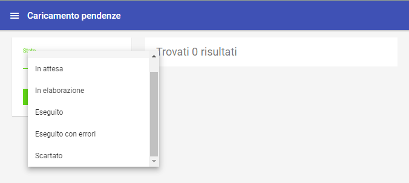

.. _govpay_caricamentimassivi:

Caricamenti Massivi
===================

La sezione *Caricamenti Massivi* è dedicata all'immissione massiva delle pendenze nel sistema
tramite tracciato.

Dal pulsante "+" in basso a destra si apre la form di caricamento seguente (finestra *Nuovo tracciato*), disponibile agli operatori
con l'autorizzazione in lettura e scrittura sulle pendenze:

   Caricamento massivo pendenze

Il form di caricamento permette di selezionare il file da caricare e di scegliere il formato del tracciato, JSON o CSV
(tipi *Standard JSON* e *Standard CSV*), oppure un formato gestito da un convertitore esterno configurato nella console
(proprietà ``it.govpay.backoffice.gui.transformerJS``). Nel caso di formato JSON
la sintassi è quella prevista dalle API Backoffice per la `POST /pendenze/tracciati/`. Nel caso di
formato CSV consultare il :ref:`utente_avanzate_csv`, tenendo presente che la sintassi di default può essere
personalizzata sia a livello di impostazioni generali della piattaforma che di tipologia di pendenza.

Per un tracciato CSV si sceglie anche l'ente creditore. Il pulsante *Impostazioni* della finestra mostra le impostazioni avanzate:

-  *Tipo tracciato*: il formato del tracciato; è preselezionato *Standard CSV*, salvo che un convertitore esterno indichi un altro formato predefinito;
-  *Trasformatore*: per un tracciato CSV, il trasformatore predefinito (*Trasformatore (Default)*) o quello di uno dei tipi pendenza
   dell'ente che ne definiscono uno;
-  *Stampa avvisi*: se attivo (predefinito), al termine dell'elaborazione vengono prodotti gli avvisi di pagamento delle pendenze caricate.

All’interno di un tracciato si definiscono le operazioni da eseguire sulle pendenze, che possono essere:

-  Inserimento di una nuova pendenza
-  Annullamento di pendenza esistente

L'elaborazione dei tracciati è asincrona ed è svolta dal core di GovPay: il tracciato caricato viene preso in carico entro pochi
secondi e un'elaborazione periodica, ogni 30 minuti, riprende comunque i tracciati ancora in attesa. L'elaborazione è abilitata dalla
proprietà ``it.govpay.batch.caricamentoTracciati.enabled`` del file ``govpay.properties`` (attiva per default).

È possibile filtrare gli elementi in base al loro stato di elaborazione, utilizzando il form presente sul lato sinistro.
Gli stati di un tracciato sono *In attesa*, *In elaborazione*, *In stampa*, *Eseguito*, *Eseguito con errori* e *Scartato*.

L'elenco a destra riporta gli elementi, visualizzandone i principali dati identificativi (identificativo del
tracciato, data di caricamento e stato dell’elaborazione).

Dettaglio Tracciato
~~~~~~~~~~~~~~~~~~~

La selezione di un elemento dell’elenco ne visualizza il dettaglio, che
comprende le seguenti informazioni:

-  *Riepilogo Informazioni*: dati generali del tracciato
   (identificativo del tracciato, data di caricamento e stato
   dell’elaborazione, operatore che ha effettuato il caricamento,
   richiesta di stampa degli avvisi, contatori delle operazioni totali, eseguite e
   fallite e, se è stata richiesta la stampa, degli avvisi totali, stampati e falliti, ... )
-  *Operazioni*: L’elenco delle operazioni eseguite a partire dal
   tracciato (tipo operazione, esito esecuzione, applicazione,
   identificativo pendenza, ... ).

Dal menu in alto a destra del dettaglio si scaricano:

-  *Scarica tracciato richiesta*: il tracciato caricato;
-  *Scarica tracciato esito*: il tracciato di esito generato dall’elaborazione;
-  *Scarica tracciato stampe avvisi*: gli avvisi di pagamento delle pendenze caricate.

Le prime due voci compaiono quando il tracciato non è più *In attesa* o *In elaborazione*; la terza solo se è stata richiesta la
stampa degli avvisi e il tracciato non è *In attesa*, *In elaborazione* o *In stampa*.

.. toctree::
   :hidden:

   formatoCSV
