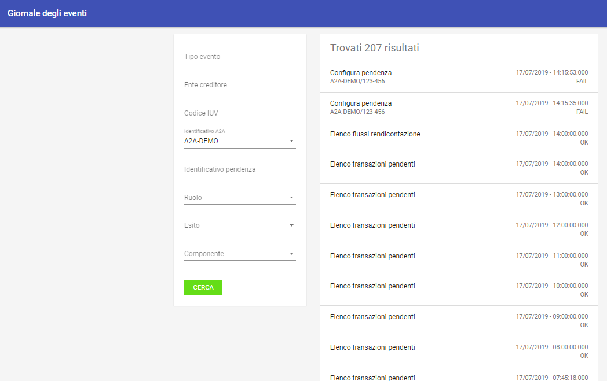
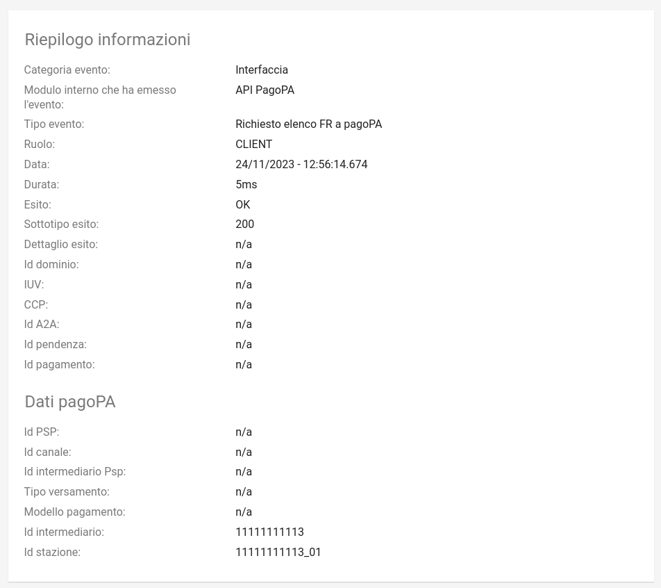
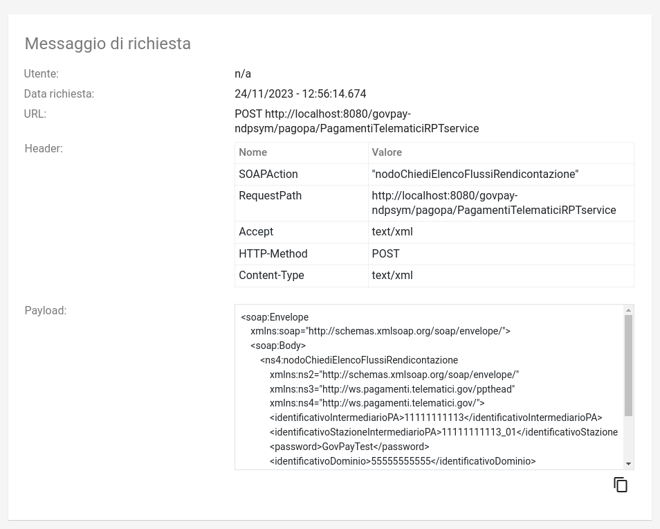
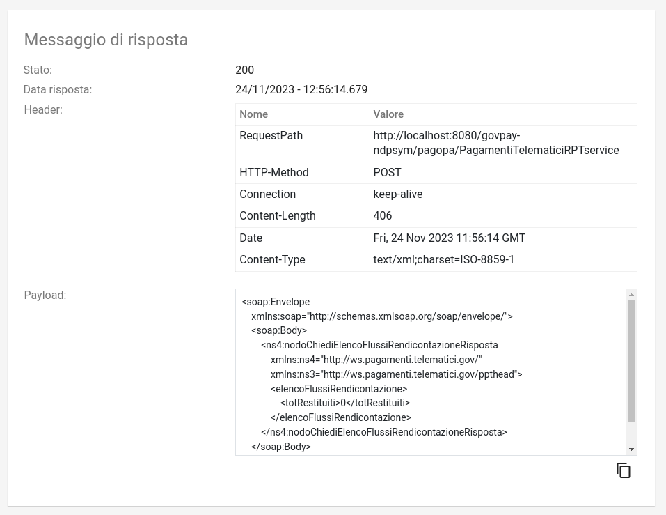

.. _utente_giornale:

Giornale degli Eventi
=====================

La sezione *Giornale degli Eventi* mostra le operazioni registrate da GovPay, con il relativo esito: le comunicazioni con la piattaforma pagoPA, le chiamate alle API di GovPay e quelle verso i servizi esterni (applicazioni dell'ente, Backend IO, connettori di esportazione), oltre agli eventi inviati dai componenti esterni tramite govpay-gde-api. Cosa registrare si stabilisce nelle :ref:`utente_impostazioni`.

Area iniziale
-------------

   Area iniziale del Giornale degli Eventi

L’elenco degli eventi visualizzati si può filtrare, utilizzando il form presente sulla sinistra.

Gli elementi dell'elenco riassumono i dati principali dell'evento e, in caso di evento di errore, risulta evidenziato tale stato.

Dopo aver effettuato una ricerca è possibile ottenere un CSV di esportazione relativo all'elenco degli eventi che soddisfano i criteri di ricerca forniti. L'esportazione dell'elenco si effettua selezionando il collegamento "Scarica resoconto" che compare sul menu a discesa azionato con l'icona in alto a destra nella pagina. Il file prodotto con l'esportazione è un tracciato CSV in cui ciascun record contiene i dati dell'evento.

Il csv contiene tutti i campi dell'evento restituiti dalla ricerca, tra cui:

*  Identificatore univoco evento
*  Componente
*  Categoria Evento
*  Ruolo
*  Tipo Evento
*  Esito
*  Data Evento
*  Durata Evento
*  Sottotipo Evento
*  Sottotipo Esito
*  Dettaglio Esito
*  idDominio
*  iuv
*  ccp
*  idA2A
*  idPendenza
*  idPagamento
*  dati PagoPA
*  Severità
*  Identificativo del nodo (clusterId)
*  Identificativo della transazione (transactionId)

Selezionando uno degli elementi dell'elenco si accede al dettaglio dell'evento, una pagina che visualizza tutte le proprietà dell'evento.

Dettaglio Evento
----------------

   Dettaglio di un Evento

Il dettaglio di un evento assiema i seguenti gruppi di informazioni relativi all'evento considerato:

* Le informazioni *interne*, ovvero tutti i puntatori tecnologici e di processo connessi all'evento
* Gli eventuali dati relativi a PagoPa connessi all'evento (presenti solo per alcune tipologie di eventi)

La voce *Vista completa* del menu in alto a destra apre in una nuova scheda del browser l'evento completo in formato JSON.

Messaggi richiesta e risposta
-----------------------------

I messaggi di richiesta e risposta vengono registrati se previsto dalla configurazione (schede *Dump Letture* e *Dump Scritture* della sezione *Registrazione degli Eventi* delle :ref:`utente_impostazioni`); i dettagli dei messaggi vengono mostrati nelle seguenti sezioni.

   Dettaglio del messaggio di richiesta

   Dettaglio del messaggio di risposta

