.. _utente_impostazioni:

Impostazioni
============

La sezione *Impostazioni* consente di configurare la piattaforma GovPay. 

Area iniziale
-------------

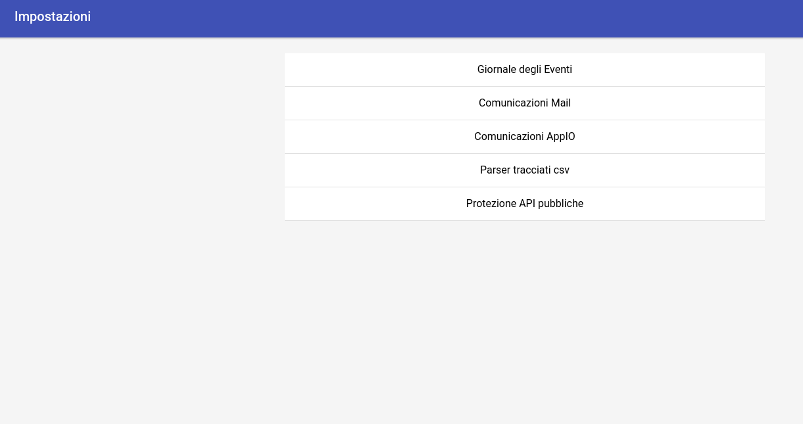

   Area iniziale Impostazioni

Il sistema consente di configurare le seguenti componenti:

*  Registrazione degli Eventi
*  Servizio Giornale Degli Eventi
*  Comunicazioni Mail
*  Comunicazioni AppIO
*  Parser tracciati csv
*  Protezione API pubbliche

Registrazione degli Eventi
--------------------------

Il sistema consente di stabilire, per ciascuna API, quali operazioni registrare nel :ref:`utente_giornale`. La configurazione è
divisa in quattro schede:

*  *Registrazione Letture* e *Registrazione Scritture*: la registrazione degli eventi relativi alle operazioni di lettura e di scrittura;
*  *Dump Letture* e *Dump Scritture*: la memorizzazione anche dei messaggi di richiesta e di risposta scambiati durante tali operazioni.

In ogni scheda, per ciascuna API (API pagoPA, API Pendenza, API Ragioneria, API Backoffice, API Ente Creditore, API Backend IO e
API Maggioli JPPA) si sceglie se registrare *Sempre*, *Mai* o *Solo errore*, cioè solo in caso di operazione conclusa con errore.

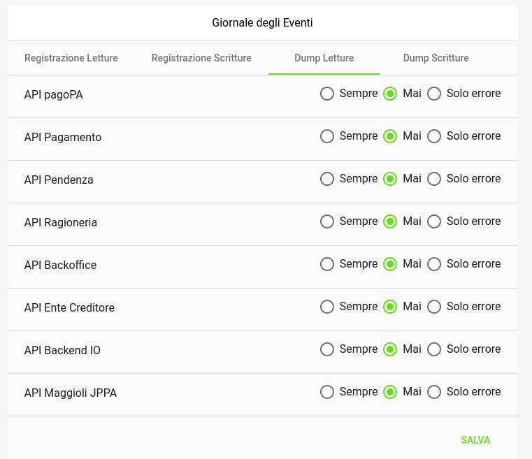

   Impostazioni Giornale degli Eventi

Servizio Giornale Degli Eventi
------------------------------

In questa sezione si configura il connettore verso govpay-gde-api, il servizio con cui i componenti esterni (per esempio
govpay-fdr-batch, govpay-rt-batch e govpay-aca-batch) registrano i loro eventi nel Giornale degli Eventi
(vedi :ref:`inst_componenti_aggiuntivi`). Si indicano:

*  *Abilitato*: attiva il connettore (disattivo per default);
*  *URL*: l'indirizzo del servizio govpay-gde-api;
*  l'eventuale autenticazione del connettore.

Comunicazioni Mail
------------------

In questa sezione si configurano le comunicazioni che GovPay manda via mail, nel primo tab si configurano i parametri per la connessione al server di posta.

I template definiti qui sono quelli generali: le comunicazioni si attivano, ed eventualmente si personalizzano, per ciascun tipo pendenza
(vedi :ref:`govpay_configurazione_enti_email`). Le mail sono spedite da task del core di GovPay, abilitati nel file ``govpay.properties``
dalle proprietà ``it.govpay.batch.spedizionePromemoria.enabled`` e ``it.govpay.batch.gestionePromemoria.enabled`` (attive per default).

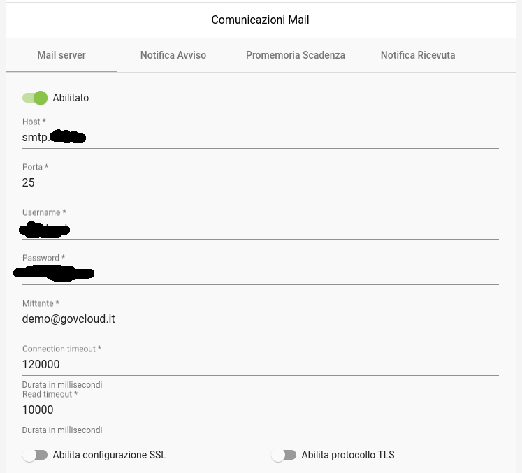

   Impostazioni Comunicazioni Mail

Più in basso nella schermata si trova la sezione per la configurazione dell'autenticazione SSL.

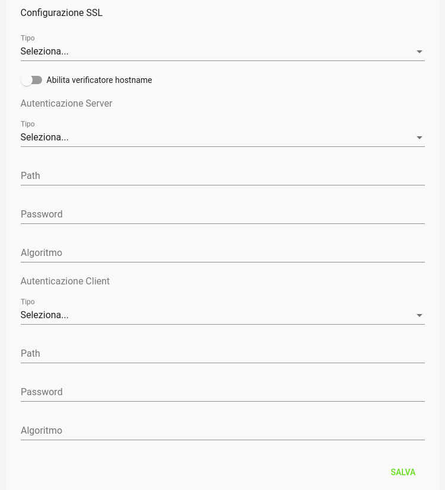

   Impostazioni Comunicazioni Mail Connessione SSL

Nei tab successivi si configurano le singole comunicazioni, definendo i template freemarker da utilizzare per la personalizzazione dei messaggi da inviare.

- Notifica Avviso

Per la notifica di un avviso si possono indicare i template per oggetto e messaggio della mail e se inserire il pdf dell'avviso di pagamento.

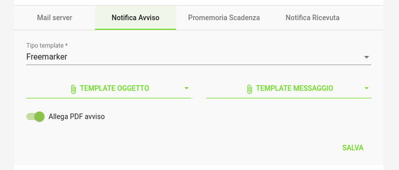

   Notifica Avviso

- Promemoria Scadenza

Per il promemoria scadenza si possono indicare i template per oggetto e messaggio della mail e i giorni di preavviso rispetto alla data di scadenza della pendenza.

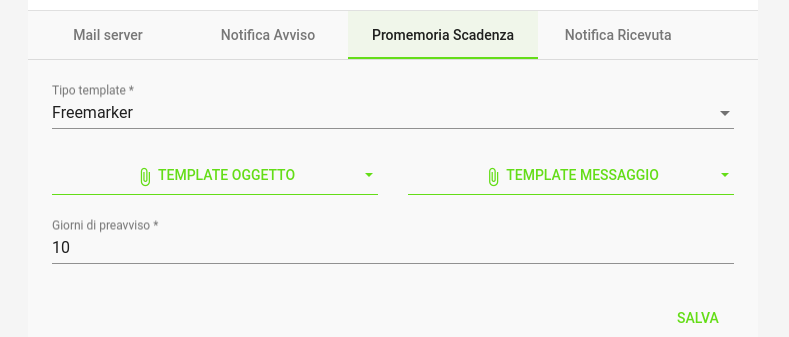

   Promemoria Scadenza

- Notifica Ricevuta

Per la notifica di una ricevuta si possono indicare i template per oggetto e messaggio della mail, se inserire il pdf della ricevuta di pagamento e se notificare solo transazioni andate a buon fine.

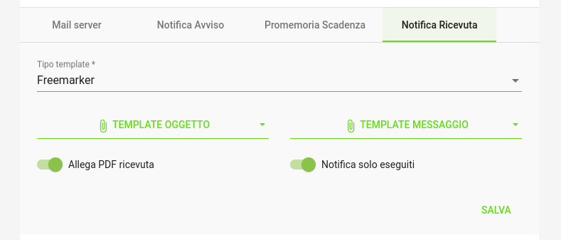

   Notifica Ricevuta

Comunicazioni AppIO
-------------------

In questa sezione si configurano le comunicazioni attraverso AppIO. Nel primo tab, *Backend server*, si configura la connessione verso il Backend IO: abilitazione (*Abilitato*), *URL backend IO*, *Time to live* dei messaggi ed eventuale autenticazione.

Anche in questo caso i template sono quelli generali: le comunicazioni si attivano, ed eventualmente si personalizzano, per ciascun tipo
pendenza (vedi :ref:`govpay_configurazione_enti_appio`). I messaggi sono spediti da un task del core di GovPay, abilitato nel file
``govpay.properties`` dalla proprietà ``it.govpay.batch.spedizioneNotificheAppIO.enabled`` (attiva per default).

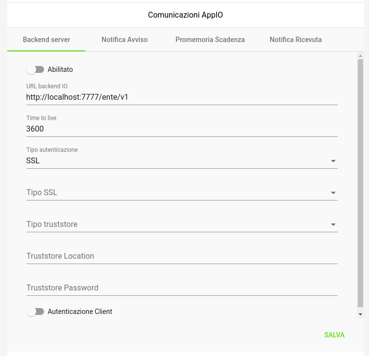

   Impostazioni Comunicazioni AppIO

Nei tab successivi si configurano le singole comunicazioni, definendo i template freemarker da utilizzare per la personalizzazione dei messaggi da inviare.

- Notifica Avviso

Per la notifica di un avviso si possono indicare i template per oggetto e testo del messaggio App IO.

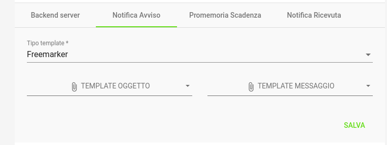

   Notifica Avviso

- Promemoria Scadenza

Per il promemoria scadenza si possono indicare i template per oggetto e testo del messaggio App IO e i giorni di preavviso rispetto alla data di scadenza della pendenza.

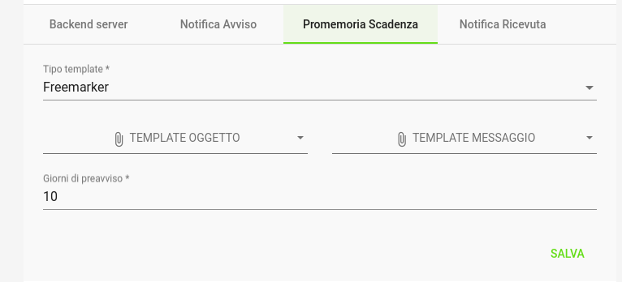

   Promemoria Scadenza

- Notifica Ricevuta

Per la notifica di una ricevuta si possono indicare i template per oggetto e testo del messaggio App IO e se notificare solo transazioni andate a buon fine.

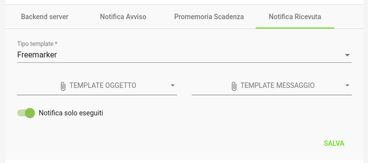

   Notifica Ricevuta

Parser tracciati csv
--------------------

In questa sezione si configura i template per la trasformazione dei tracciati di caricamento pendenze in formato CSV.

Si possono indicare:
- Template Caricamento: definisce la trasformazione dal singola riga del tracciato CSV in una pendenza in formato JSON delle API native.
- Template Esito: definisce la trasformazione del risultato del caricamento in una riga in formato CSV da inserire nel tracciato di esito.
- Linea Intestazione: definisce l'header da inserire nel tracciato di esito

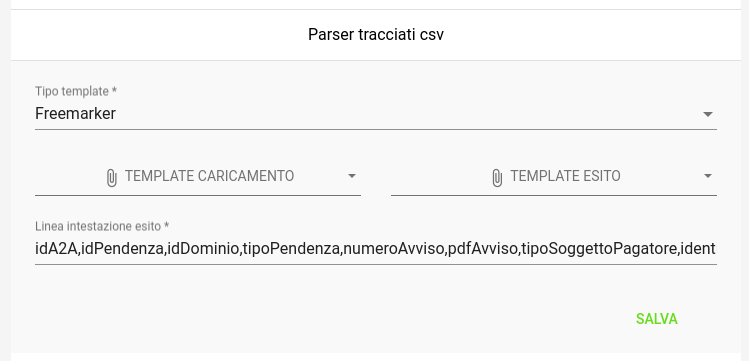

   Impostazioni Parser CSV

Protezione API pubbliche
------------------------

In questa sezione si configura la protezione tramite Captcha delle risorse pubbliche messe a disposizione da GovPay ai portali di pagamento.

Si indicano l'abilitazione (*Abilitato*), la *URL verifica* del servizio Captcha, la *Chiave del sito* e la *Chiave segreta*, la *Soglia*,
il nome della proprietà della risposta che contiene il token (*Nome property response*), i timeout di connessione e di lettura e se
bloccare la richiesta quando la verifica non riesce (*Blocca se non verifica*).

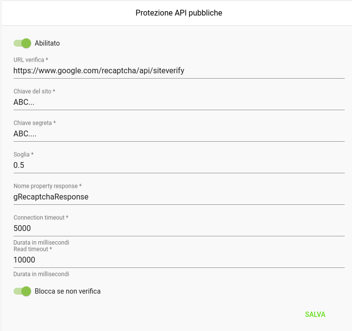

   Impostazioni API Pubbliche

