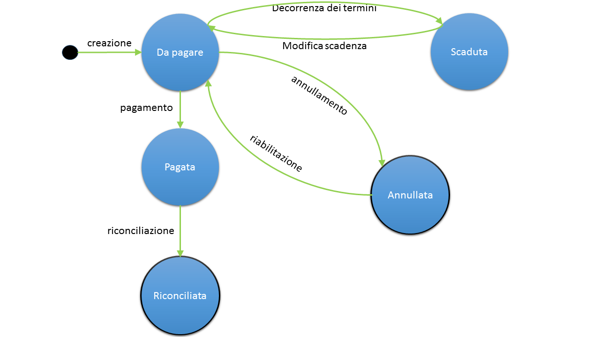
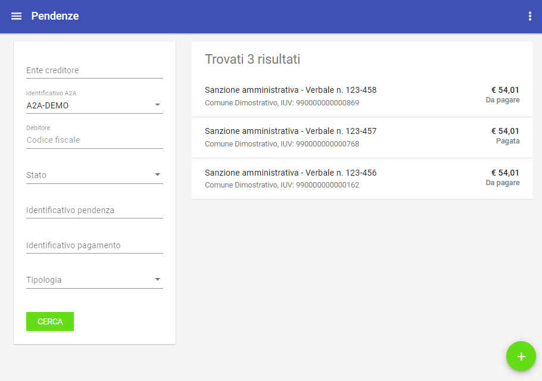
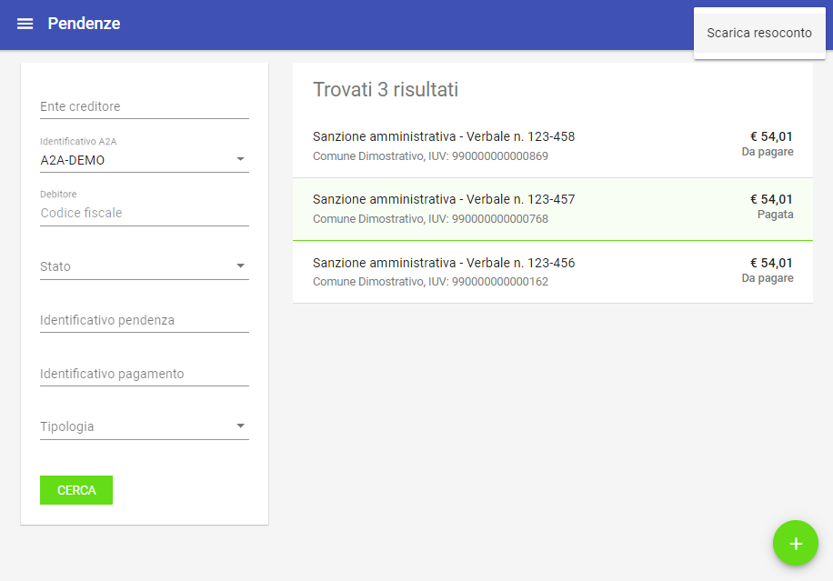
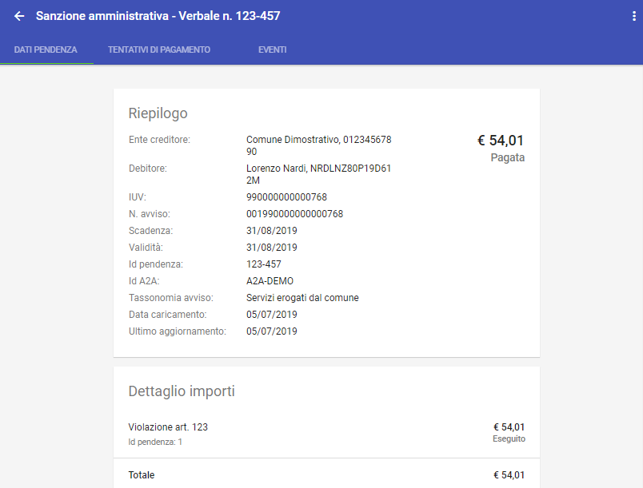
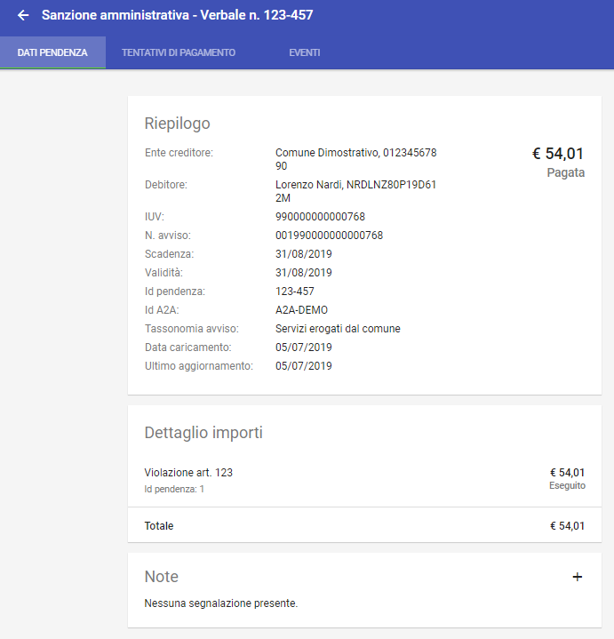
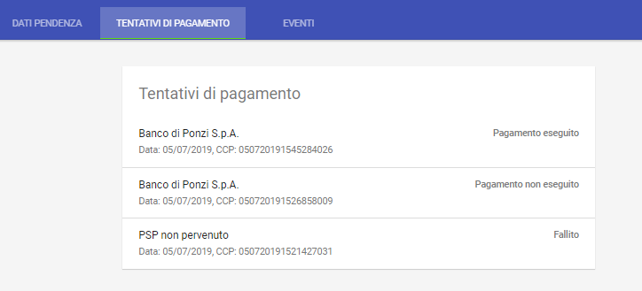

.. _utente_pendenze:

Pendenze
========

Questa sezione è dedicata alla consultazione delle pendenze di pagamento presenti nel repository dei pagamenti in attesa. Le pendenze sono pagabili sui canali pagoPA tramite il relativo avviso di pagamento.

Gli stati della Pendenza
------------------------
Si noti come, all'interno del sistema, il diagramma di stato delle pendenze sia il seguente:

   Diagramma degli stati della Pendenza

Si noti come si arrivi a e si parta da lo stato *annullata* solo a seguito di azioni dell'operatore.

La console mostra gli stati seguenti, che si possono usare anche come filtro di ricerca:

.. csv-table:: Stati della pendenza
  :header: "Stato", "Descrizione", "Note"
  :widths: 20,60,20

  "Da pagare", "Stato iniziale della pendenza", ""
  "Non pubblicata", "Pendenza da pagare con una data di pubblicazione futura: fino a quella data l'avviso non è pagabile", "Dalla versione 3.10"
  "Scaduta", "Pendenza da pagare la cui data di scadenza è decorsa", ""
  "Pagata", "Stato che indica il regolare pagamento della pendenza", ""
  "Pagata parzialmente", "Stato che indica che la pendenza è stata pagata solo in parte", ""
  "Riconciliata", "Stato che indica il completamento del processo di riconciliazione della pendenza con la somma incassata", ""
  "Annullata", "Stato assegnato alla pendenza dopo che ne è stato richiesto l'annullamento", ""
  "Anomala", "Stato che segnala un'anomalia rilevata sul pagamento della pendenza, per esempio una ricevuta non coerente con i dati della pendenza", "Il motivo è riportato nel campo *Descrizione stato* del dettaglio"

Area iniziale
-------------

   Area iniziale delle Pendenze

L'area iniziale è composta dai seguenti elementi:

*  Sulla sinistra è presente il form per impostare i criteri di filtro sulle pendenze su cui si intende agire: ente creditore, codice IUV,
   applicazione, identificativo della pendenza, debitore, stato, tipo pendenza, identificativo del pagamento e intervallo di date.
   L'interruttore *Nascondi spontanei* esclude dall'elenco le pendenze spontanee non pagate.
*  Sulla destra è presente l'elenco delle pendenze che corrispondono ai criteri di filtro impostati, con un insieme sommario di dati. Oltre al titolo, troviamo la codifica IUV, l'importo complessivo, lo stato e la data.

Dopo aver effettuato una ricerca è possibile ottenere un CSV di esportazione relativo all'elenco delle pendenze che soddisfano i criteri
di ricerca forniti. L'esportazione dell'elenco si effettua selezionando il collegamento *Scarica Resoconto* che compare sul menu a discesa in alto a destra, come mostrato in figura:

   Scarica csv delle pendenze trovate

I campi del csv (compresso in formato zip) sono i seguenti:

* Identificativo dell'applicazione (idA2A)
* Identificativo univoco della pendenza
* Identificativo del dominio
* Denominazione del dominio
* Numero di avviso
* Importo
* Data del caricamento della pendenza
* Data di validità della pendenza
* Data di scadenza della pendenza
* Tassonomia avviso
* Stato della pendenza

Selezionando uno degli elementi presenti in elenco si procede alla visualizzazione del dettaglio della pendenza, abilitando l'eventuale modifica.

Dettaglio Pendenza
------------------

La pagina di dettaglio fornisce una vista delle singole informazioni che compongono la pendenza stessa.

   Dettaglio della pendenza

In testa, sulla destra, è presente un menu a discesa che consente, nel caso si possiedano le necessarie autorizzazioni, di effettuare le
seguenti operazioni (tutte, tranne *Scarica resoconto*, richiedono l'autorizzazione in scrittura sulle pendenze):

-  Annulla pendenza / Ripristina pendenza

   Se la pendenza è *Da pagare* o *Non pubblicata* è possibile annullarla, facendola transitare nello stato *Annullata*.
   All’atto dell’annullamento viene richiesto di fornire un testo di motivazione dell’operazione che verrà visualizzato nella pagina di elenco e veicolato ai PSP nel caso ne venisse tentato il pagamento.
   Una pendenza *Annullata* si può ripristinare con l'operazione "Ripristina pendenza", che la riporta tra le pendenze da pagare.
   Anche nel caso del ripristino è possibile opzionalmente inserire un testo di descrizione della motivazione.

-  Scarica avviso

   Presente per le pendenze *Da pagare* o *Non pubblicata*, consente di scaricare l'avviso di pagamento in formato PDF.

-  Stampa ricevuta

   Presente per le pendenze *Pagata* o *Riconciliata*, consente di scaricare la ricevuta di pagamento in formato PDF.

-  Scarica resoconto

   Consente di scaricare un archivio in formato ZIP che contiene i
   documenti che compongono la pendenza, quali:

   -  L'avviso di pagamento in PDF (``<idDominio>_<numeroAvviso>.pdf``), se la pendenza ha un numero di avviso e non è una marca da bollo.
   -  Una cartella per ciascun tentativo di pagamento, con la RPT (``Rpt.xml``), gli eventi del tentativo (``Eventi.csv``) e,
      se presente, la ricevuta in formato XML e PDF (``Rt.xml`` e ``Rt.pdf``).
   -  Il documento CSV ``Eventi.csv`` con tutti gli eventi della pendenza.

La presentazione dei dati di dettaglio della pendenza è articolata in tre differenti sezioni raggiungibili selezionando altrettanti schede:

-  Dati Pendenza
-  Tentativi di Pagamento
-  Eventi

Nel seguito si dettagliano i gruppi informativi appena elencati.

Dati Pendenza
~~~~~~~~~~~~~

   Dati pendenza

La pagina riporta nella sezione **Riepilogo** i dati principali che compongono la pendenza (ente creditore, debitore, IUV, scadenza,
importo, stato, ...). Il valore assunto dallo stato è un elemento importante che consente ad esempio, in fase di ricerca, di selezionare le sole pendenze che non risultino pagate.
Quando presenti, il riepilogo riporta anche la data di pubblicazione (*Pubblicazione*), la data dell'ultimo aggiornamento e quella dell'ultimo invio
all'Archivio Centralizzato degli Avvisi (*Ultimo aggiornamento*, *Ultimo invio all'ACA*) e, per le pendenze *Anomala*, la *Descrizione stato*.

Seguono le sezioni:

-  **Vista personalizzata**, se il tipo pendenza ne definisce una: riporta, con il titolo configurato, i campi scelti per il dettaglio.
-  **Dettaglio importi**: l'elenco delle singole voci di pagamento contenute nella pendenza (titolo, importo, stato), con il totale.
-  **Altre informazioni**, se presenti: le proprietà dell'avviso e della ricevuta di pagamento e i dati allegati alla pendenza (*Dati Custom*).
-  **Allegati**: i documenti allegati alla pendenza.
-  **Note**: le eventuali segnalazioni associate alla pendenza che sono state rilevate dal sistema durante il suo ciclo di vita. Il sistema consente di inserire nuove note con la solita modalità (click sul tasto più).

Tentativi di Pagamento
~~~~~~~~~~~~~~~~~~~~~~

Questa sezione mostra i dati relativi alle transazioni di pagamento che sono state effettuate per pagare la pendenza (la banca, la data, l'importo, l'esito).
Il clic su ciascun elemento in elenco comporta un'espansione con la visualizzazione di ulteriori dati di dettaglio, se disponibili.

   Tentativi di pagamento di una data pendenza

Se tra i tentativi ce n'è uno con la ricevuta accettata ed esito di pagamento non eseguito, il menu della sezione propone la voce
*Sostituisci RT*: si seleziona il file XML della nuova ricevuta, il cui IUV deve corrispondere a quello di un tentativo della pendenza,
e la ricevuta del tentativo viene sostituita.

Eventi
~~~~~~

Questa sezione mostra l'elenco degli eventi, presenti nel Giornale degli Eventi, previsto dalla specifica pagoPA, che sono scaturiti nel corso del ciclo di vita della pendenza che si sta consultando. Maggiori dettagli su questi elementi sono riportati nella sezione :ref:`utente_giornale`, dove è descritta la funzionalità di consultazione generale del Giornale degli Eventi.
