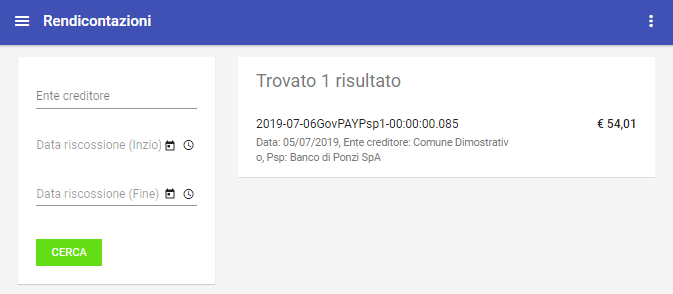
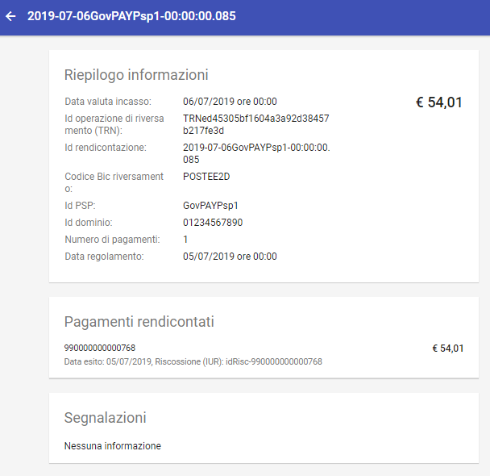

.. _govpay_rendicontazioni:

Rendicontazioni
===============

La sezione *Rendicontazioni* è dedicata alla consultazione dei flussi di rendicontazione acquisiti da pagoPA. La
pagina iniziale mostra l’elenco dei flussi di rendicontazione presenti nel repository.

I flussi sono acquisiti dal componente esterno govpay-fdr-batch (vedi :ref:`inst_componenti_aggiuntivi`), che si può avviare
anche a richiesta dalla sezione :ref:`utente_manutenzione`.

   Area Generale Rendicontazioni

Per ciascuna rendicontazione in elenco, oltre ai riferimenti identificativi (identificativo, psp, ente creditore, ...), sono segnalati, con indicazione dello stato, i casi di errore.

È possibile filtrare gli elementi visualizzati utilizzando il form presente sul lato sinistro. L'interruttore *Escludi Duplicati*
esclude dall'elenco i flussi obsoleti, cioè le revisioni di un flusso sostituite da una revisione successiva.

È possibile scaricare un file CSV con i dati delle rendicontazioni, visualizzate con il criterio di ricerca impostato, utilizzando la voce "Scarica Resoconto" presente nel menu a destra sulla testata della pagina.

La selezione di un elemento dell’elenco ne visualizza il dettaglio, come mostrato:

   Dettaglio Rendicontazione

Dettaglio Rendicontazione
~~~~~~~~~~~~~~~~~~~~~~~~~

La pagina di dettaglio della rendicontazione si compone delle seguenti sezioni:

-  *Riepilogo Informazioni*: riporta i dati identificativi della rendicontazione (identificativo flusso, psp, ente creditore, importo,
   ...)
-  *Pagamenti Rendicontati*: Le singole voci di rendicontazione che riguardano ciascun pagamento rendicontato (voce, importo, stato, ...)
-  *Segnalazioni*: L'elenco delle eventuali segnalazioni che sono state sollevate dal sistema durante la gestione del flusso di
   rendicontazione.

Dal menu in alto a destra del dettaglio si scarica il flusso di rendicontazione in formato XML (*Scarica flusso XML*)
o in formato CSV (*Scarica flusso CSV*).
