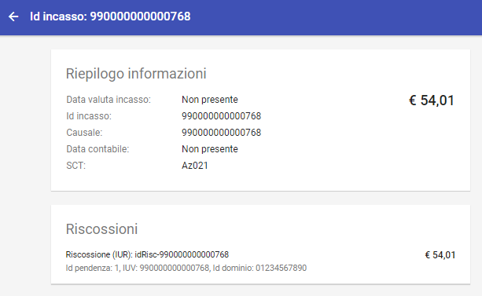
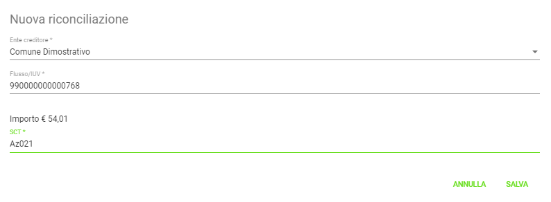

.. _utente_riconciliazioni:

Riconciliazioni
===============

Area Generale
-------------

La sezione “Riconciliazioni” è dedicata alla consultazione delle voci di riconciliazione delle riscossioni notificate
dalla banca tesoriera. Tali informazioni vengono registrate sulla piattaforma dagli applicativi che gestiscono il processo di
riconciliazione con la Banca Tesoriera.

È possibile filtrare gli elementi visualizzati nella pagina utilizzando il form presente sul lato sinistro, per identificativo flusso,
codice IUV, identificativo PSP del riversamento (SCT), ente creditore, stato e intervallo di date.
Gli stati di una riconciliazione sono *Acquisita*, *In Elaborazione* ed *Errore*.

L'elenco sul lato destro riporta gli elementi visualizzandone i principali dati identificativi:

   Area iniziale Riconciliazioni

È possibile scaricare un file CSV con i dati delle riconciliazioni, visualizzate con il criterio di ricerca impostato, utilizzando la voce "Scarica Resoconto" presente nel menu sulla testata della pagina a destra. Il sistema permetterà il download di un file in formato zip che contiene:

-  un file riassuntivo in formato csv, con tutti i dati delle riconciliazioni in elenco (ente creditore, identificativo,
   causale, importo, date, IBAN di accredito, SCT, stato, ...);
-  per ciascuna riconciliazione, un file csv con il nome dell'identificativo del flusso (o dello IUV) che elenca le riscossioni
   riconciliate: ente creditore, identificativo del flusso, IUV, importo, data, identificativo e tipo della pendenza,
   identificativo della voce, dati allegati della pendenza e della voce e quote di contabilità.

Dettaglio Riconciliazione
-------------------------

La selezione di un elemento dell’elenco ne visualizza il dettaglio, che comprende le seguenti informazioni:

-  *Riepilogo Informazioni* – dati generali della riscossione con i
   riferimenti del movimento bancario che lo ha determinato.
-  *Riscossioni* – elenco delle riscossioni riconciliate con le pendenze
   di origine.

   Dettaglio Riconciliazione

Nuova Riconciliazione
---------------------
Il sistema permette la creazione di una nuova riconciliazione con le abituali metafore grafiche (tasto + in basso a destra):

   Nuova Riconciliazione

Si sceglie l'ente creditore e, nel campo *Identificativo flusso*, si cerca il flusso di rendicontazione da riconciliare tra quelli
acquisiti per l'ente e non ancora riconciliati. Selezionato il flusso, l'identificativo PSP del riversamento (SCT) e l'importo sono
compilati automaticamente e mostrati in sola lettura; si conferma quindi il salvataggio.
