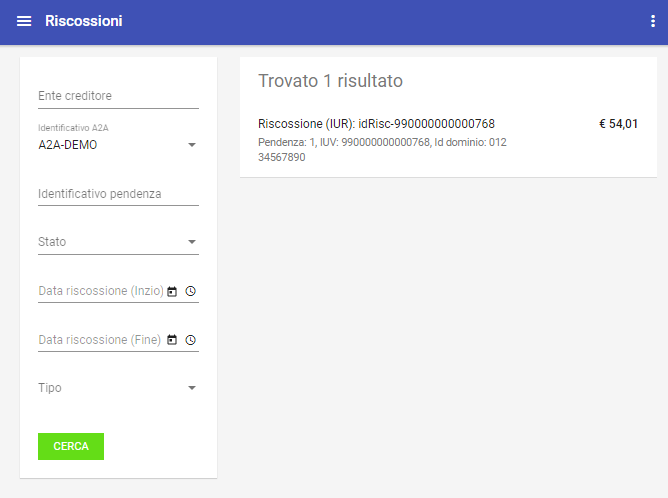
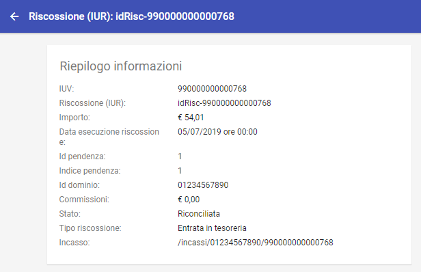

.. _utente_riscossioni:

Riscossioni
===========

La sezione *Riscossioni* è dedicata alla consultazione delle somme che sono state correttamente riscosse tramite i versamenti operati dai debitori.

Visualizzazione della sezione
-----------------------------

La sezione è nascosta di default. Si abilita nel file di configurazione della console ``assets/Config.js``
(con l'immagine Docker, il ``Config.js`` esterno sul volume di configurazione), impostando la proprietà seguente:

.. code-block:: javascript
   :linenos:

   global.GovPayConfig = {
       GESTIONE_RISCOSSIONI: {
           ENABLED: true // abilita la sezione riscossioni
       }
   };

Il valore iniziale del file viene dalla proprietà ``it.govpay.backoffice.gui.sezioneRiscossioni.enabled`` (predefinita ``false``)
usata nella compilazione e dall'installer.

Con la sezione abilitata, la voce "Prospetto riscossioni attese" si sposta dalla sezione :ref:`govpay_ricevute` al menu di questa sezione.

Dettaglio sezione
-----------------

Anche in questo caso risulta possibile filtrare gli elementi presenti nella pagina tramite il form presente sul lato sinistro. Di rilevante importanza è la possibilità di filtrare in base allo stato della riscossione:

-  *Riscossa* - è lo stato iniziale relativo agli importi riversati ma non ancora riconciliati.
-  *Riconciliata* - è lo stato finale che indica che tutti gli importi di una determinata pendenza sono stati già riconciliati con le somme riversate.

È inoltre possibile selezionare le riscossioni in base al tipo. Esistono due tipi di riscossione:

-  *Entrata in Tesoreria*: Sono cifre riscosse dai PSP che verranno riversate sul conto della banca tesoriera dell'ente creditore. Si
   tratta di somme soggette a riconciliazione.
-  *Marca da Bollo Telematica*: Sono cifre riscosse dai PSP per il rilascio di una marca da bollo. Tali importi non saranno accreditati
   all'ente e quindi non sono soggetti a riconciliazione.

   Area Generale Riscossioni

È possibile scaricare un file CSV con i dati delle riscossioni, visualizzate con il criterio di ricerca impostato, utilizzando la voce
"Scarica Resoconto" presente nel menu a destra sulla testata della pagina.

Selezionando il singolo elemento dall’elenco si accede alla pagina di dettaglio che riporta ulteriori informazioni non modificabili:

   Dettaglio Riscossione
