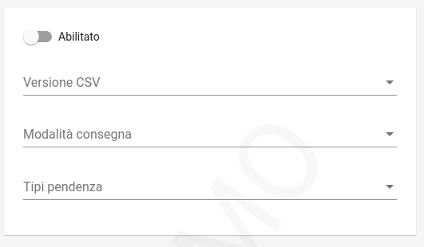

.. _govpay_configurazione_connettori_govpay:

Connettore per l'esportazione dei pagamenti in standard GovPay
--------------------------------------------------------------

Questo connettore consente di esportare i dati dei pagamenti gestiti da GovPay per l'esportazione verso applicativi terzi: 

   Configurazione del Connettore GovPay

.. csv-table:: *Parametri di configurazione*
   :header: "Campo", "Descrizione"
   :widths: 40,60

   "Abilitato", "Abilita o disabilita il connettore"
   "Versione ZIP", "Versione del tracciato utilizzata per l'esportazione (1.0)"
   "Modalità consegna", "Canale di trasmissione del tracciato verso l'ente: Email, File System o REST"
   "Tipi pendenza", "Elenco dei tipi pendenza oggetto di esportazione (anche tutti)"
   "Intervallo creazione", "Intervallo, in ore, coperto da ciascun tracciato"

In base alla modalità di consegna si configurano i seguenti parametri:

.. csv-table:: *Parametri della modalità di consegna*
   :header: "Modalità", "Campo", "Descrizione"
   :widths: 20,30,50

   "Email", "Email", "Indirizzi a cui spedire il tracciato"
   "Email", "Oggetto", "Oggetto della mail"
   "Email", "Invia tracciato come allegato", "Se attivo il tracciato è allegato alla mail, altrimenti la mail contiene il link per scaricarlo"
   "Email", "Base URL link download", "URL base del link di download inserito nella mail"
   "File System", "Path", "Directory in cui viene salvato il tracciato"
   "REST", "Contenuti", "Contenuti da inviare al servizio: Sintesi pagamenti, Sintesi flussi rendicontazione, RPP, Flussi rendicontazione"
   "REST", "URL", "URL base del servizio REST dell'ente che riceve i dati"
   "REST", "Versione API", "Versione delle API di integrazione (``REST v1``)"
   "REST", "Autenticazione", "Modalità di autenticazione di GovPay verso il servizio"

Con la consegna REST GovPay non spedisce l'archivio ma invia con una ``POST`` ciascun contenuto selezionato al servizio dell'ente:

* Sintesi pagamenti: CSV dei pagamenti su ``/rpp/{idDominio}/{idTracciato}``
* RPP: richiesta e ricevuta di ciascun pagamento, in JSON, su ``/rpp/{id}``
* Sintesi flussi rendicontazione: CSV delle rendicontazioni su ``/flussiRendicontazione/{idDominio}/{idTracciato}``
* Flussi rendicontazione: XML di ciascun flusso su ``/flussiRendicontazione/{idDominio}/{id}``

Con le modalità Email e File System il tracciato esportato viene nominato con il seguente pattern: ``GOVPAY_{idDominio}_{progressivo}.zip``

Il tracciato viene creato ogni giorno alle 3 di mattina, se dall'ultimo tracciato è trascorso l'intervallo di creazione configurato, e viene spedito da un task eseguito ogni 30 minuti.
Entrambi i task sono **disattivati per default**: per attivarli va impostata a ``true`` la proprietà ``it.govpay.batch.caricamentoTracciatiNotificaPagamenti.enabled`` nel file ``govpay.properties``.

Versione 1.0
~~~~~~~~~~~~

L'archivio contiene le seguenti informazioni:

* File json con i metadati dell'estrazione, come il periodo di osservazione, tipipendenza estratti, versione, etc.. (metadata.json)
* File CSV con la sintesi dei pagamenti ricevuti (govpay_rendicontazione.csv)
* File CSV con la sintesi dei flussi rendicontazione (govpay_flussi_rendicontazione.csv)
* File XML originale pagoPA delle ricevute telematiche: (``RT/{idDominio}_{iuv}_{ccp}/rt.xml``) e, se presente, della richiesta di pagamento (``RT/{idDominio}_{iuv}_{ccp}/rpt.xml``)
* File XML originale pagoPA dei flussi di rendicontazione: (``FlussiRendicontazione/{idFlusso}_{dataFlusso}_rev{revisione}.xml``)

Tracciato CSV dei pagamenti ricevuti
^^^^^^^^^^^^^^^^^^^^^^^^^^^^^^^^^^^^

Per ciascuna riscossione viene aggiunto un record nel tracciato con le seguenti informazioni

* idA2A: da pendenza
* idPendenza: da pendenza
* idDocumento: da pendenza
* descrizioneDocumento: da pendenza
* codiceRata: da pendenza
* dataScadenza: da pendenza
* idVocePendenza: da pendenza
* descrizioneVocePendenza: da vocePendenza.descrizione
* idTipoPendenza: da pendenza
* descrizione: da pendenza.causale
* anno: da pendenza
* identificativoDebitore: da RT
* anagraficaDebitore: da RT
* identificativoDominio: da RT
* identificativoUnivocoVersamento: da RT
* codiceContestoPagamento:da RT
* indiceDati: da RT
* identificativoUnivocoRiscossione: da RT
* modelloPagamento: da RT
* singoloImportoPagato: da RT
* dataEsitoSingoloPagamento: da RT
* causaleVersamento: da RT
* datiSpecificiRiscossione: da RT
* datiAllegati: da Pendenza
* datiAllegatiVoce: da vocePendenza
* denominazioneAttestante: da RT
* identificativoAttestante: da RT
* contabilita: da vocePendenza

Tracciato CSV delle rendicontazioni
^^^^^^^^^^^^^^^^^^^^^^^^^^^^^^^^^^^

Per ciascuna rendicontazione contenuta nei flussi ricevuti da pagoPA viene aggiunto un record nel tracciato con le seguenti informazioni:

* identificativoFlusso: da FR.identificativoFlusso
* dataOraFlusso: da FR.dataOraFlusso
* identificativoDominio: da FR.codDominio
* identificativoUnivocoRegolamento: da FR.identificativoUnivocoRegolamento
* dataRegolamento: da FR.dataRegolamento
* codiceBicBancaDiRiversamento: da FR.codiceBicBancaDiRiversamento
* numeroTotalePagamenti: da FR.numeroTotalePagamenti
* importoTotalePagamenti: da FR.importoTotalePagamenti
* identificativoUnivocoVersamento: da FR.ctDatiSingoliPagamenti[i].identificativoUnivocoVersamento
* identificativoUnivocoRiscossione: da FR.ctDatiSingoliPagamenti[i].identificativoUnivocoRiscossione
* indiceDatiSingoloPagamento: da FR.ctDatiSingoliPagamenti[i].indiceDatiSingoloPagamento
* singoloImportoPagato: da FR.ctDatiSingoliPagamenti[i].singoloImportoPagato
* codiceEsitoSingoloPagamento: da FR.ctDatiSingoliPagamenti[i].codiceEsitoSingoloPagamento
* dataEsitoSingoloPagamento: da FR.ctDatiSingoliPagamenti[i].dataEsitoSingoloPagamento
* denominazioneMittente: da FR.istitutoMittente.denominazioneMittente
* identificativoMittente: da FR.istitutoMittente.identificativoUnivocoMittente.codiceIdentificativoUnivoco
* denominazioneRicevente: da FR.istitutoRicevente.denominazioneRicevente
* identificativoRicevente: da FR.istitutoRicevente.identificativoUnivocoRicevente.codiceIdentificativoUnivoco

