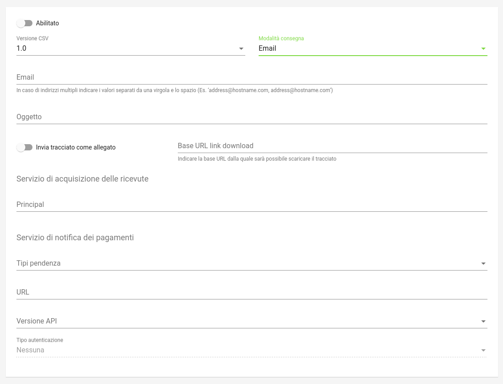

.. _govpay_configurazione_connettori_jppa:

Connettore per la notifica dei pagamenti verso Maggioli (JPPA)
--------------------------------------------------------------

Il connettore consente di notificare al gateway pagamenti Maggioli JPPA le ricevute di pagamento gestite da GovPay.

La notifica non è eseguita dal core di GovPay ma dal componente esterno **govpay-maggioli-jppa**, da installare a parte (vedi :ref:`inst_componenti_aggiuntivi`). Per ogni Ente Creditore con il connettore abilitato, il componente:

- cerca le ricevute positive (esito 0 o 2) arrivate dopo l'ultima già notificata;
- si autentica sul gateway Maggioli con l'utente e la password del connettore;
- invia una notifica REST per ogni ricevuta, con l'XML della ricevuta in Base64 e i dati di accertamento ricavati dalla contabilità delle voci della pendenza (per ogni quota: anno di esercizio, capitolo e importo, con la descrizione della voce);
- se previsto dal connettore, produce un tracciato CSV con l'esito di ogni notifica e lo spedisce per email.

Dalla console di GovPay si configura solo il connettore dell'Ente Creditore.

   Configurazione del Connettore Maggioli (JPPA)

.. csv-table:: *Servizio REST Maggioli JPPA*
   :header: "Campo", "Descrizione"
   :widths: 40,60

   "Base URL dei servizi", "URL base dell'API del gateway Maggioli JPPA"
   "Username", "Utente con cui il componente si autentica sul gateway"
   "Password", "Password con cui il componente si autentica sul gateway"
   "Data ultima RT", "Data dell'ultima ricevuta notificata, aggiornata dal componente a ogni esecuzione: le ricevute successive a questa data vengono notificate all'esecuzione seguente. Per inviare di nuovo delle ricevute va riportata indietro"
   "Abilitato", "Abilita o disabilita la notifica dei pagamenti per l'Ente Creditore"

.. csv-table:: *Invio tracciato esito*
   :header: "Campo", "Descrizione"
   :widths: 40,60

   "Invia tracciato esito", "Se attivo, al termine di ogni esecuzione viene prodotto il tracciato CSV con l'esito delle notifiche e spedito per email"
   "Path file system", "Directory in cui viene salvato il tracciato"
   "Email", "Indirizzi destinatari del tracciato, separati da virgola"
   "Oggetto", "Oggetto della email"

La spedizione del tracciato di esito richiede anche che l'invio delle email sia configurato nelle impostazioni di GovPay (vedi :ref:`utente_impostazioni`).

La schedulazione del componente, l'avvio manuale, il formato del tracciato di esito e le altre proprietà sono descritti nel README del repository `govpay-maggioli-jppa <https://github.com/link-it/govpay-maggioli-jppa>`_.
