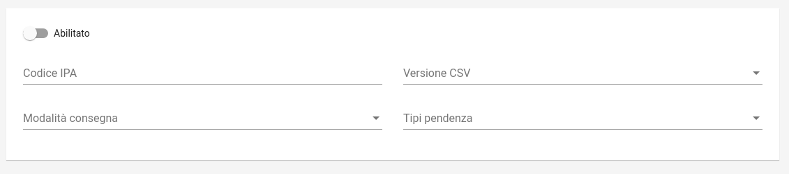

.. _govpay_configurazione_connettori_mypivot:

Connettore per l'esportazione dei pagamenti verso MyPIVOT
------------------------------------------------------------

Questo connettore consente di esportare i dati dei pagamenti gestiti da GovPay in formato compatibile con
l'applicativo di riconciliazione MyPIVOT.

Il tracciato viene creato ogni giorno alle 3 di mattina, se dall'ultimo tracciato è trascorso l'intervallo di creazione configurato, e viene spedito da un task eseguito ogni 30 minuti.
Entrambi i task sono **disattivati per default**: per attivarli va impostata a ``true`` la proprietà ``it.govpay.batch.caricamentoTracciatiNotificaPagamenti.enabled`` nel file ``govpay.properties``.

   Configurazione del Connettore MyPIVOT

.. csv-table:: *Parametri di configurazione*
   :header: "Campo", "Descrizione"
   :widths: 40,60

   "Abilitato", "Abilita o disabilita il connettore"
   "Codice IPA", "Identificativo sull'Indice della Pubblica Amministrazione usato nella compilazione del CSV"
   "Versione CSV", "Versione del tracciato utilizzata per l'esportazione (1.0)"
   "Modalità consegna", "Canale di trasmissione del CSV verso l'ente: Email o File System"
   "Tipi pendenza", "Elenco dei tipi pendenza oggetto di esportazione"
   "Intervallo creazione", "Intervallo, in ore, coperto da ciascun tracciato"
   "Email", "Se selezionata la consegna email, specifica la lista degli indirizzi destinatari separati da virgola"
   "Oggetto", "Se selezionata la consegna email, specifica l'oggetto della mail"
   "Invia tracciato come allegato", "Se selezionata la consegna email, indica se il tracciato deve essere inserito in allegato o riferito con un link"
   "Base URL link download", "Se deselezionato l'invio come allegato, indica la base URL del link di download"
   "Path", "Se selezionata la consegna File System, specifica il path sul server dove verranno depositati i file"

Il tracciato esportato è un archivio ``GOVPAY_{idDominio}_{progressivo}.zip`` che contiene il CSV ``GOVPAY_{idDominio}_{progressivo}.csv``.

Versione 1.0
~~~~~~~~~~~~

Il tracciato è conforme alla nota tecnica `MyPivot Integrazione Ente <https://www.regione.puglia.it/documents/410606/413675/MyPivot+-+Nota+tecnica+Integrazione+Ente+V.5.6.2.pdf/60cc0453-c0ec-3076-77bf-5794f2171116?t=1591803805170>`_
valorizzando i campi con le seguenti convenzioni (i percorsi indicati sono quelli della ricevuta nel formato RT; per le ricevute ``paSendRT`` si usano i campi equivalenti di ``receipt`` e ``debtor``):

.. csv-table:: *Valori di esportazione*
   :header: "Campo", "Descrizione"
   :widths: 40,60

   "IUD", "idA2A@idPendenza"
   "codIuv", "rt.datiPagamento.identificativoUnivocoVersamento"
   "tipoIdentificativoUnivoco", "rt.datiPagamento.soggettoPagatore.identificativoUnivocoPagatore.tipoIdentificativoUnivoco"
   "codiceIdentificativoUnivoco", "rt.datiPagamento.soggettoPagatore.identificativoUnivocoPagatore.codiceIdentificativoUnivoco"
   "anagraficaPagatore", "rt.datiPagamento.soggettoPagatore.anagraficaPagatore"
   "indirizzoPagatore", "rt.datiPagamento.soggettoPagatore.indirizzoPagatore"
   "civicoPagatore", "rt.datiPagamento.soggettoPagatore.civicoPagatore"
   "capPagatore", "rt.datiPagamento.soggettoPagatore.capPagatore"
   "localitaPagatore", "rt.datiPagamento.soggettoPagatore.localitaPagatore"
   "provinciaPagatore", "rt.datiPagamento.soggettoPagatore.provinciaPagatore"
   "nazionePagatore", "rt.datiPagamento.soggettoPagatore.nazionePagatore"
   "mailPagatore", "rt.datiPagamento.soggettoPagatore.e-mailPagatore"
   "dataEsecuzionePagamento", "rt.datiPagamento.datiSingoloPagamento[0].dataEsitoSingoloPagamento"
   "importoDovutoPagato", "rt.datiPagamento.importoTotalePagato"
   "commissioneCaricoPa", "vuoto"
   "tipoDovuto", "pendenza.vocePendenza[0].contabilita.proprietaCustom.tipoDovuto o versamento.tassonomiaEnte o versamento.codTipoPendenza"
   "tipoVersamento", "vuoto"
   "causaleVersamento", "rt.datiPagamento.datiSingoloPagamento[0].causaleVersamento"
   "datiSpecificiRiscossione", "rt.datiPagamento.datiSingoloPagamento[0].datiSpecificiRiscossione"
   "bilancio", "xml costruito con le informazioni indicate in pendenza.vocePendenza[0].contabilita.quote"
