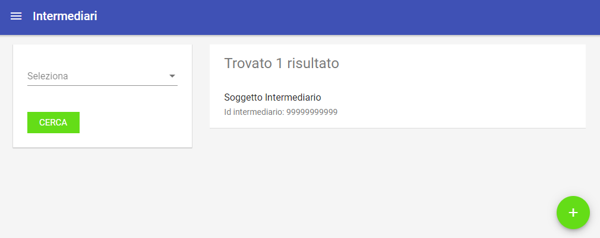
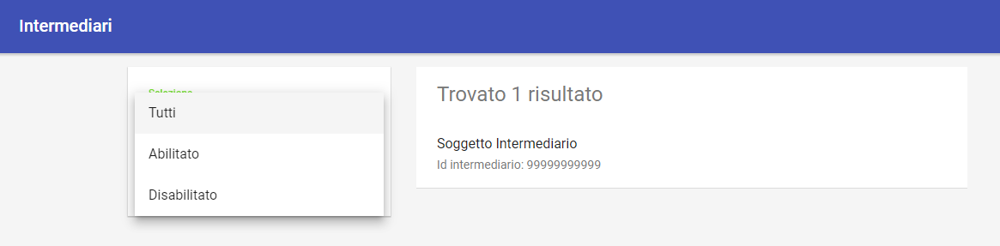
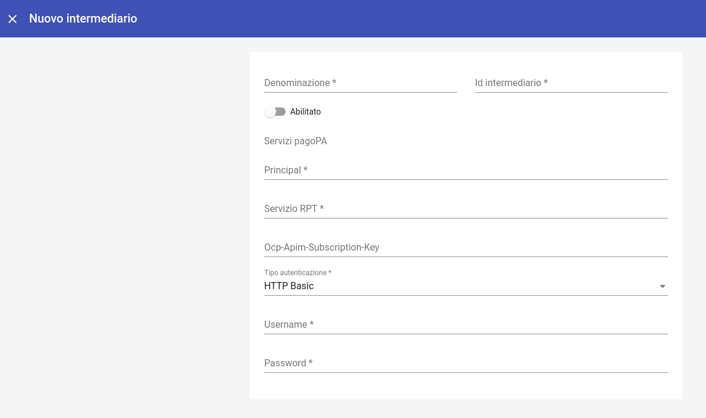
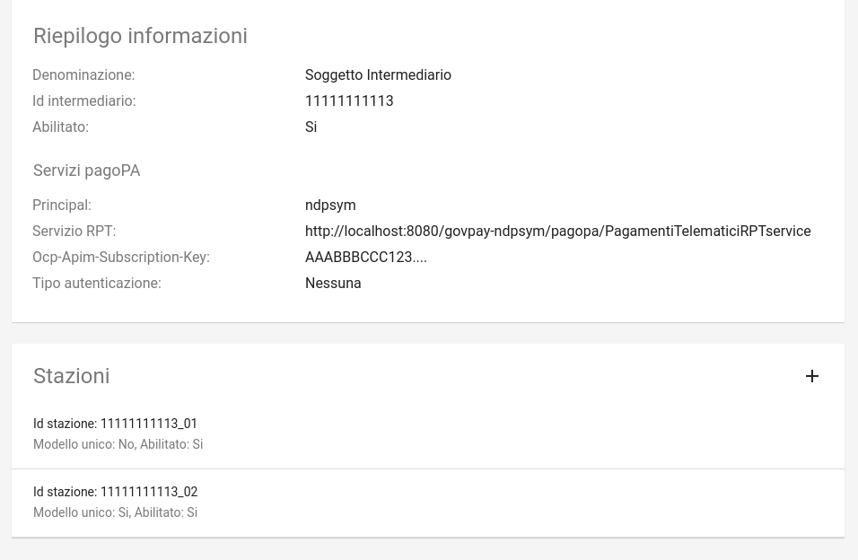
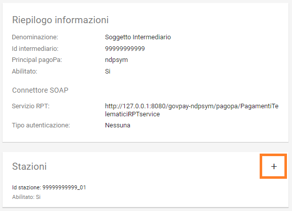
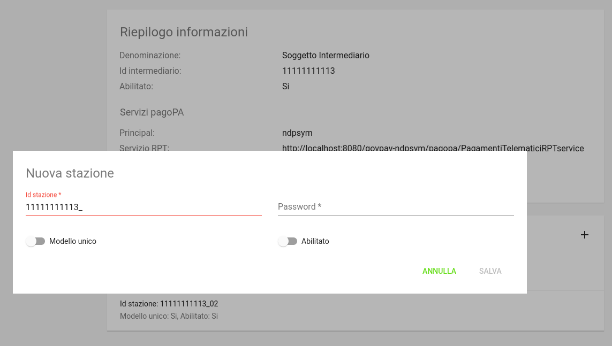
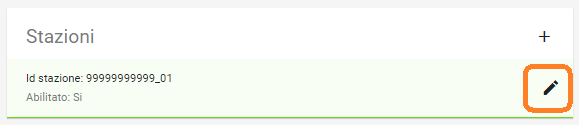
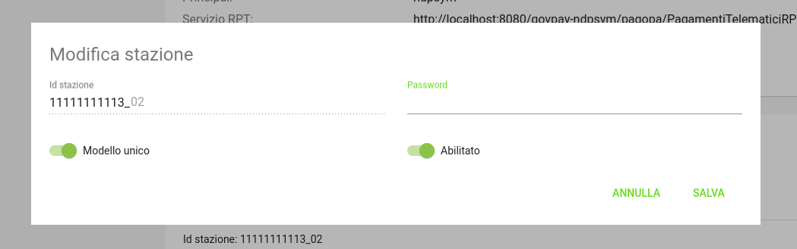

.. _govpay_configurazione_intermediari:

Intermediari
===============

Gli intermediari o partner tecnologici sono entità censite da PagoPA S.p.A. sul circuito pagoPA al momento dell'adesione di un Ente Creditore. Per il corretto funzionamento di GovPay, gli intermediari di interesse devono essere censiti con le informazioni di corredo necessarie.

   Vista di dettaglio intermediari

Accedendo alla sezione corrispondente (*Configurazioni > Intermediari*), viene visualizzato l'elenco degli intermediari censiti
sul sistema. È possibile filtrare gli intermediari in relazione al loro stato, impostandolo nella casella di selezione posta a sinistra, come di seguito mostrato:

   Filtro su ricerca Intermediari

Nuovo Intermediario
~~~~~~~~~~~~~~~~~~~

Per inserire un nuovo intermediario è necessario premere l'apposito
pulsante, presente nella pagina di elenco in basso a destra, e compilare il form che viene
aperto:

   Informazioni che definiscono un nuovo intermediario

Le informazioni contenute nel form sono le seguenti:

.. csv-table:: Dettagli di un nuovo intermediario
   :header: "Campo", "Significato", "Note"
   :widths: 40,40,20

   "Denominazione", "Nome associato all'Intermediario o al Partner Tecnologico", "Obbligatorio"
   "Id Intermediario", "Identificativo dell'intermediario o Partner Tecnologico, fornito da PagoPA S.p.A., corrisponde alla Partita IVA del soggetto", "Obbligatorio"
   "Principal", "identificativo (subject certificato o principal) corrispondente alle credenziali con cui Govpay riceve le chiamate in entrata da pagoPA", "Obbligatorio"
   "Abilitato/Non Abilitato", "Stato del nuovo intermediario: indica se l'intermediario è usabile da GovPay per gestire nuovi pagamenti o se impedire nuove richieste.", ""
   "Url", "Riferimenti utilizzati da Govpay per comunicare con il Nodo SPC: Endpoint per le chiamate in uscita verso il Nodo SPC", "Obbligatorio"
   "Ocp-Apim-Subscription-Key", "Chiave da inviare a PagoPA per accedere ad alcune risorse, identifica il soggetto chiamante e consente l'accesso alle sole risorse autorizzate", ""
   "Tipo Autenticazione", "Lista a discesa per selezionare il tipo di autenticazione adottata per le comunicazioni con il Nodo SPC. Si può scegliere, al momento, tra *Nessuna e HTTP-Basic, SSL, Header, API-Key e OAuth2 Client Credentials*. Per ogni modalità di autenticazione, dovranno essere inserite i relativi dati di configurazione previsti", ""

Per abilitare il servizio di recupero delle ricevute da pagoPA, eseguito dal componente govpay-rt-batch, inserire le seguenti informazioni nella sezione Servizio recupero RT:

.. csv-table:: Dettagli Connettore Recupero RT
   :header: "Campo", "Significato", "Note"
   :widths: 40,40,20

   "Url", "Riferimenti utilizzati da Govpay per comunicare il servizio di recupero RT di pagoPA: Endpoint per le chiamate in uscita verso il servizio BizEvents di pagoPA", "Obbligatorio"
   "Ocp-Apim-Subscription-Key", "Chiave da inviare a PagoPA per accedere ad alcune risorse, identifica il soggetto chiamante e consente l'accesso alle sole risorse autorizzate", "Obbligatori"
   "Tipo Autenticazione", "Lista a discesa per selezionare il tipo di autenticazione adottata per le comunicazioni con pagoPA. Si può scegliere, al momento, tra *Nessuna e HTTP-Basic, SSL, Header, API-Key e OAuth2 Client Credentials*. Per ogni modalità di autenticazione, dovranno essere inserite i relativi dati di configurazione previsti", ""

Il form contiene anche le sezioni dei connettori verso gli altri servizi pagoPA usati dai componenti esterni di GovPay (vedi :ref:`inst_componenti_aggiuntivi`).
Ciascuna sezione ha gli stessi campi del Servizio recupero RT (Url, Ocp-Apim-Subscription-Key e Tipo Autenticazione) e va compilata solo se si usa il componente corrispondente:

.. csv-table:: Altri servizi pagoPA dell'intermediario
   :header: "Sezione", "Servizio pagoPA", "Componente che lo usa"
   :widths: 25,45,30

   "Servizio ACA", "Gestione Posizioni Debitorie (GPD), per l'invio delle posizioni debitorie all'Archivio Centralizzato degli Avvisi", "govpay-aca-batch"
   "Servizio FR", "Flussi di Rendicontazione (FdR), per l'acquisizione dei flussi di rendicontazione", "govpay-fdr-batch"
   "Servizio Backoffice EC", "Backoffice degli Enti Creditori, per la verifica degli IBAN e dell'anagrafica degli enti", "govpay-iban-batch"

Selezionando un intermediario dalla pagina che li elenca si accede alla pagina di dettaglio.

Dettaglio Intermediario
~~~~~~~~~~~~~~~~~~~~~~~

La pagina di dettaglio di un intermediario mostra i singoli campi che lo
compongono unitamente all'elenco delle stazioni ad esso associate.
Infatti, al censimento di un Intermediario o Partner Tecnologico, PagoPA S.p.A.
assegna anche una o più Stazioni Tecnologiche che devono essere
registrate su GovPay.

   Pulsante di modifica

Il pulsante di modifica presente nella pagina consente di aprire il form
per modificare le proprietà dell'intermediario.

Stazioni
~~~~~~~~

Nella pagina di dettaglio dell'intermediario (quindi una volta che lo si è creato) esiste una sezione dedicata alle
stazioni in cui è possibile aggiungerne di nuove:

   Pulsante di aggiunta stazione (evidenziato in rosso)

Si ottiene così il seguente risultato:

   Maschera di inserimento di una nuova stazione

Per definire una stazione connessa all'intermediario occorre immettere le seguenti informazioni:

.. csv-table:: Dettagli di una nuova stazione
   :header: "Campo", "Significato", "Note"
   :widths: 30,40,30

   "IdStazione", "Identificativo della stazione, fornito da PagoPA S.p.A.", "Obbligatorio"
   "Password", "Chiave segreta, fornita da PagoPA S.p.A.", "Obbligatorio se disabilitato il Modello unico"
   "Abilitato", "Indica se la stazione è usabile da GovPay per gestire nuovi pagamenti (abilitato)
   o se si vogliono impedire nuove richieste (disabilitato)", ""
   "Modello unico", "Indica se la stazione supporta il Modello unico di pagamento", ""

.. note:: Si noti come le stazioni siano connesse univocamente a ciascun intermediario, non è quindi possibile avere una stessa stazione connessa a due intermediari

È possibile visualizzare il dettaglio di una stazione selezionandola dall’elenco, avendo il dettaglio dei campi appena visti.

In corrispondenza di ciascuna stazione in elenco si evidenzia il pulsante per la modifica delle informazioni:

   Modifica di una stazione esistente

I dati modificabili della stazione saranno la password, il flag *Modello unico* e lo stato; l'identificativo non sarà modificabile:

   Maschera di modifica di una stazione

Una volta terminata la modifica è necessaria la pressione della voce *Salva* per renderla effettiva.
