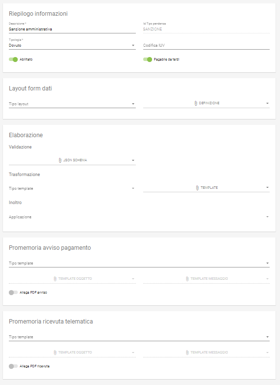
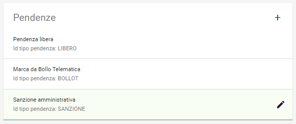
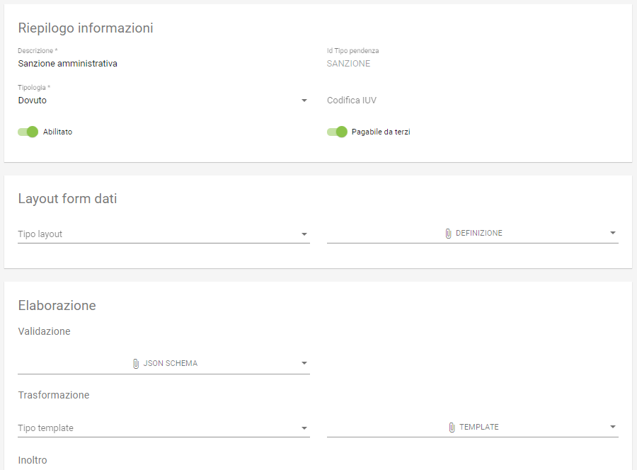
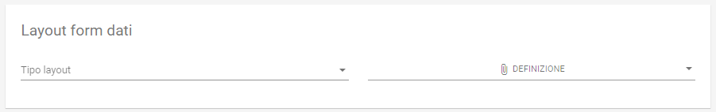
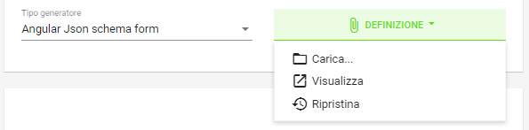
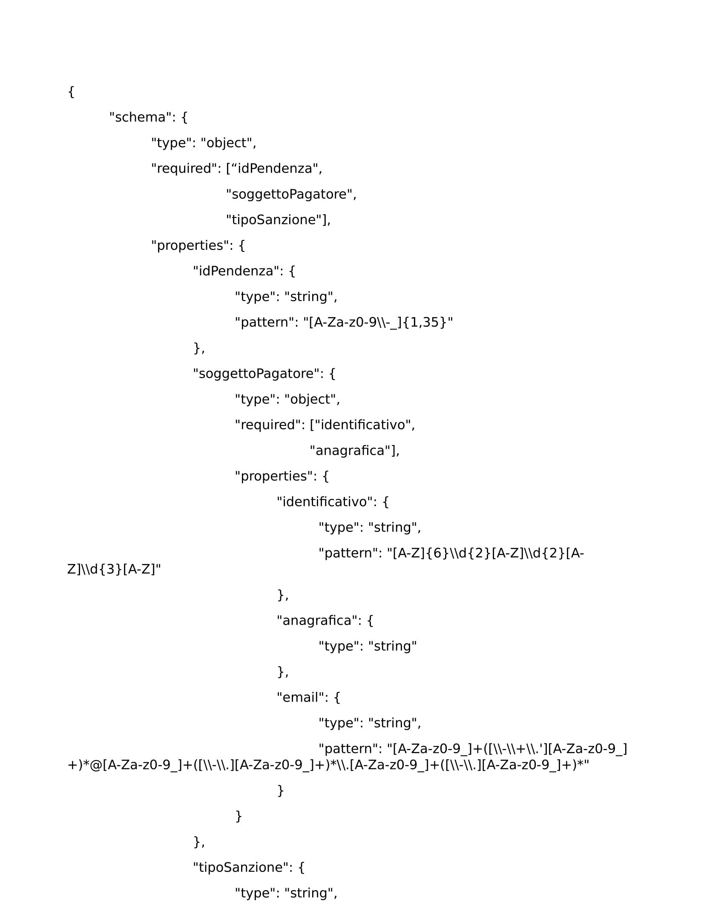
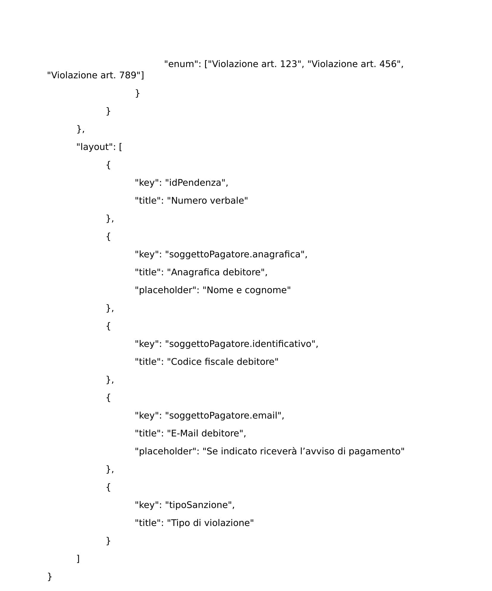
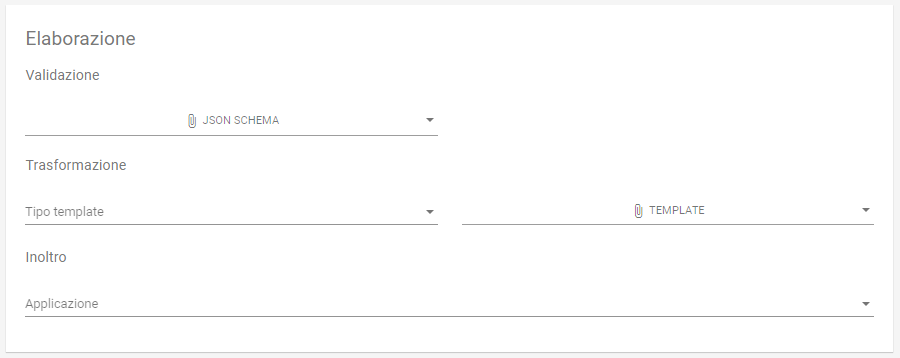
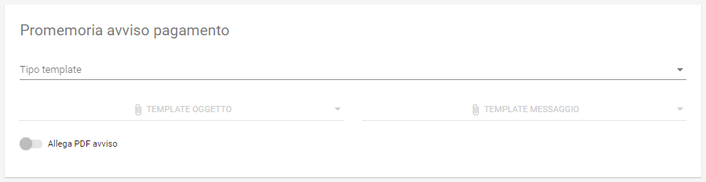
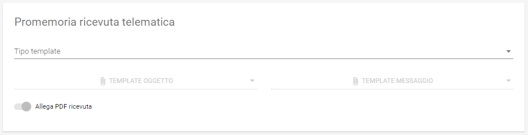

.. _govpay_configurazione_tipipendenze:

Tipi Pendenze
-------------

Ogni pendenza gestita dal sistema appartiene a un tipo pendenza censito in questa anagrafica. Il tipo pendenza raccoglie la configurazione comune alle pendenze dello stesso genere: codifica negli IUV, form di inserimento da operatore e di pagamento spontaneo, comunicazioni al cittadino e altre funzioni.
I tipi pendenza vengono poi associati agli Enti Creditori nella sezione *Tipi Pendenza* del dettaglio dell'ente (vedi :ref:`govpay_configurazione_enti`), dove la configurazione di base definita in questa anagrafica può essere personalizzata per il singolo ente.
La gestione dei tipi di pendenza permette la generazione di maschere automatiche per l'immissione dei dati, semplificando in modo notevole lo sviluppo di interfacce e ottimizzando i tempi generali di progetto.
Le modalità per la creazione di un nuovo tipo pendenza sono sempre le medesime (tasto più in basso a destra) e la maschera presentata è la seguente:

   Maschera di creazione di un nuovo Tipo Pendenza

Vediamo come modificare un tipo pendenza esistente; ciò ci permetterà di illustrare il dettaglio dei campi presenti. Selezioniamo, ad esempio, il tipo pendenza *Sanzione Amministrativa*.

   Selezione del tipo pendenza *Sanzione Amministrativa*

Il sistema mostra la seguente maschera

   Modifica del tipo pendenza *Sanzione Amministrativa*

Possiamo identificare i seguenti raggruppamenti di informazioni:

* Riepilogo informazioni
* Inserimento pendenze da operatore
* Pagamento spontaneo
* Comunicazioni via email
* Comunicazioni via App IO
* Altre funzioni

Le sezioni diverse dal riepilogo hanno gli stessi campi della configurazione del tipo pendenza associato a un Ente Creditore, descritti nelle pagine dedicate: i valori impostati in questa anagrafica sono i valori di base, che l'ente può sovrascrivere.

Riepilogo informazioni
~~~~~~~~~~~~~~~~~~~~~~
La sottosezione si presenta nel seguente modo:

   Sezione Riepilogo Informazioni

.. csv-table:: Campi modificabili della prima sezione
   :header: "Campo", "Significato", "Note"
   :widths: 40,40,20

   "Descrizione", "Descrizione sintetica del tipo di pendenza", ""
   "Id Tipo Pendenza", "Codice tecnico che indica in modo univoco il tipo pendenza", "Non modificabile"
   "Codifica IUV", "Identificatore della struttura del codice IUV", ""
   "Abilitato", "Indica se il tipo pendenza è abilitato o meno, quindi se è o meno associabile agli Enti Creditori", ""
   "Pagabile da terzi", "Indica se le pendenze di questo tipo possono essere pagate da un soggetto diverso dal debitore", ""

Inserimento pendenze da operatore
~~~~~~~~~~~~~~~~~~~~~~~~~~~~~~~~~

La sezione definisce la form con cui un operatore inserisce dalla console le pendenze di questo tipo, la validazione dei dati inseriti,
la loro trasformazione in una pendenza e l'eventuale inoltro a un'applicazione. I campi sono descritti in :ref:`govpay_configurazione_enti_formoperatore`.

   Sezione form della *Sanzione Amministrativa*

Il *Tipo layout* indica il motore di interpretazione della definizione della form: *Angular Json schema form* oppure *SurveyJS*.
Per i file di definizione, validazione e trasformazione è presente un menu di caricamento e visualizzazione:

   Funzionalità selezionabili per la definizione form

Sono presenti le voci:

* *Carica*: carica un nuovo file di definizione del form
* *Visualizza*: visualizza la definizione del form
* *Ripristina*: ripristina la definizione originaria del form

Vediamo un esempio di un file di definizione dell'interfaccia:

   Funzionalità selezionabili per la definizione form

Le sottosezioni *Validazione*, *Trasformazione dati* e *Inoltro* consentono a GovPay di descrivere in modo formale come elaborare quanto immesso nella form al fine di trasformare e inoltrare le informazioni alle applicazioni (anche esterne) che ne abbisognino.

   Validazione, trasformazione e inoltro dei dati della form

.. csv-table:: Dettagli di validazione, trasformazione e inoltro
   :header: "Campo", "Significato", "Note"
   :widths: 40,40,20

   "Validazione", "Selezione delle funzionalità sulla definizione della validazione in formato Json Schema", "* Carica
   * Visualizza
   * Ripristina"
   "Trasformazione: tipo template", "Motore di trasformazione delle informazioni immesse nella form", "Freemarker"
   "Trasformazione: Template", "Template di definizione della trasformazione dati", "* Carica
   * Visualizza
   * Ripristina"
   "Inoltro", "Consente di selezionare l'applicazione cui verranno inoltrati i dati", "L'applicazione deve essere censita nella sezione *Applicazioni*"

Pagamento spontaneo
~~~~~~~~~~~~~~~~~~~

La sezione definisce la form con cui il cittadino paga spontaneamente le pendenze di questo tipo da un portale dei pagamenti, con la relativa impaginazione, validazione, trasformazione e inoltro. I campi sono descritti in :ref:`govpay_configurazione_enti_spontaneo`.

Comunicazioni via email
~~~~~~~~~~~~~~~~~~~~~~~

La sezione configura le comunicazioni automatiche via email al debitore: notifica dell'avviso di pagamento, promemoria della scadenza e notifica della ricevuta. I campi sono descritti in :ref:`govpay_configurazione_enti_email`. La definizione dell'oggetto e del corpo della mail è, al momento, basata su `Freemarker <https://freemarker.apache.org/>`_.

   Informazioni della notifica dell'avviso di pagamento

   Informazioni della notifica della ricevuta

Comunicazioni via App IO
~~~~~~~~~~~~~~~~~~~~~~~~

La sezione configura le stesse comunicazioni inviate come messaggi App IO. I campi sono descritti in :ref:`govpay_configurazione_enti_appio`.

Altre funzioni
~~~~~~~~~~~~~~

La sezione configura il parser dei tracciati CSV di caricamento massivo e la personalizzazione del dettaglio della pendenza in console. I campi sono descritti in :ref:`govpay_configurazione_enti_altrefunzioni`.

Esempio di scenario di utilizzo
~~~~~~~~~~~~~~~~~~~~~~~~~~~~~~~
Come esempio di scenario di utilizzo possiamo cercare di mappare, sui componenti presentati, un semplice processo reale: si supponga di gestire, infatti, il pagamento spontaneo di dieci buoni pasto elettronici con relativo inoltro della codifica elettronica univoca, previo pagamento andato a buon fine, al richiedente.

.. csv-table:: Gestione buoni pasto elettronici
   :header: "#", "Configurazione del tipo pendenza", "Passo di processo"
   :widths: 20,40,40

   "1", "Pagamento spontaneo: Form inserimento dati", "Definizione form in cui si chiede il numero di buoni pasto richiesti"
   "2", "Pagamento spontaneo: Validazione", "Gestione delle soglie (es. massimo 20 buoni pasti a richiesta)"
   "3", "Pagamento spontaneo: Trasformazione dati", "Creazione della pendenza correlata al numero di buoni mensa effettivamente richiesti (es. determinazione del costo finale, con le varie franchigie, aggravi amministrativi e via dicendo)"
   "4", "Pagamento spontaneo: Inoltro", "Interfacciamento con l'applicazione verticale che crea i codici relativi ai buoni mensa richiesti"

È di tutta evidenza come **questo non sia che uno dei molteplici processi che sono formalmente definibili, quindi implementabili direttamente, con i meccanismi appena visti, da GovPay**.
