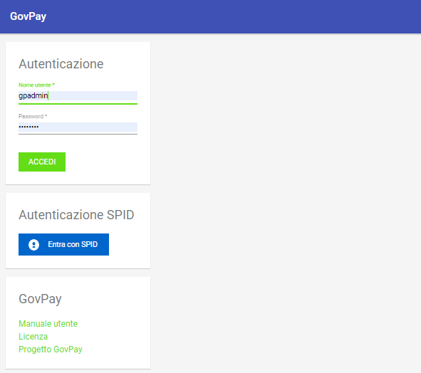
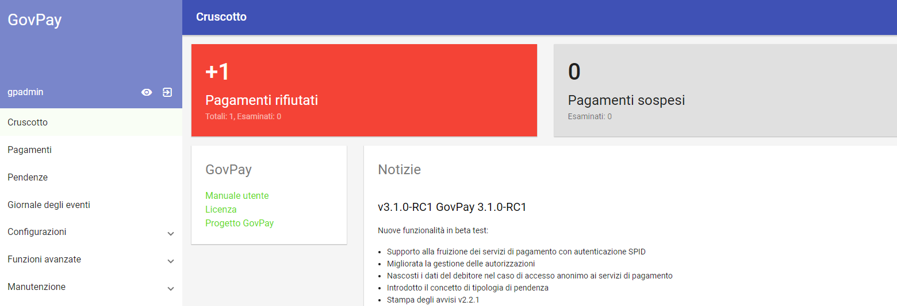
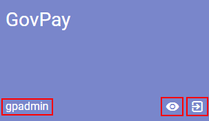
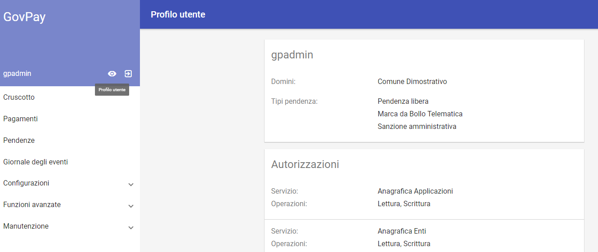
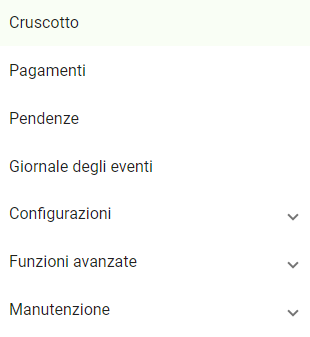

.. _govpay_console:

=========
Cruscotto
=========

Una volta completata con successo la procedura di installazione sarà possibile procedere con la configurazione accedendo al **Cruscotto di Gestione** al seguente indirizzo:

``http://<hostname>:<port>/govpay-console/``

Dove al posto dei placeholder <hostname> e <port> dovranno essere inseriti i riferimenti al proprio ambiente di installazione (nome host o indirizzo IP e relativa porta).

.. note:: Questa sezione descrive la console inclusa nel core di GovPay. In alternativa è disponibile la nuova console di backoffice, distribuita come componente separato insieme al servizio REST che la alimenta: per installazione e configurazione si vedano i README dei repository `govpay-console <https://github.com/link-it/govpay-console>`_ e `govpay-console-api <https://github.com/link-it/govpay-console-api>`_ (vedi anche :ref:`inst_componenti_aggiuntivi`).

Sono disponibili le seguenti funzionalità informative, liberamente consultabili prima dell'autenticazione:

*  **Manuale Utente**, che permette di accedere alla versione più recente di questo manuale in formato PDF
*  **Progetto GovPay**, che apre il repository GitHub del progetto, dove sono illustrate le caratteristiche salienti del prodotto e le sue novità

Per l'accesso al cruscotto viene presentata la maschera per l'immissione delle credenziali. Si noti come ad ogni
utente sia associato un *ruolo* che rappresenta l'insieme delle funzionalità che sono destinate all'utente stesso. Questo meccanismo, che verrà maggiormente dettagliato in seguito, permette di *ritagliare* in modo assolutamente generico il giusto profilo funzionale per tutte le classi di utente abilitati all'uso della piattaforma.

   Immissione delle credenziali [#]_

.. [#] Ovviamente le credenziali evidenziate in figura sono a puro scopo esemplificativo

I metodi di autenticazione al sistema sono:

*  Username / password
*  OAuth2 / OpenID Connect, con il flusso *authorization code* e PKCE verso un identity provider esterno
*  autenticazione delegata a un IAM, che inoltra l'identità dell'utente in un header HTTP
*  `SPID <https://www.spid.gov.it/>`_

I metodi disponibili si abilitano nel file di configurazione della console ``assets/Config.js`` (blocchi ``BASIC``, ``OAUTH2``, ``IAM`` e ``SPID``) e devono corrispondere alle modalità di autenticazione attive sulle API Backoffice (vedi :ref:`inst_dispiegamento_auth`).

Si noti che il sistema abilita l'accesso tramite SPID se l'Ente ha effettuato tutti i necessari passi per accreditarsi all'uso di SPID stesso (certificazioni, test e via dicendo).

Dopo aver effettuato l’accesso con le credenziali in proprio possesso, si accede a tutte le funzionalità descritte nelle corrispondenti sezioni di questo documento. La schermata dovrebbe presentarsi in questo modo [#]_

.. [#] Si tenga sempre presente che la propria schermata dipende dai ruoli cui si è associati

   Schermata iniziale [#]_

.. [#] Si noti come le funzionalità evidenziate corrispondono a un ruolo particolare: l'utente che si autentica, a seconda dei ruoli cui è associato, potrà vedere tutte o parte delle funzionalità in figura

La colonna posta sinistra nell'interfaccia rappresenta il menu di navigazione, con le relative voci che variano in funzione dei ruoli associati all'utenza autenticata.

L'area iniziale (primo box in alto a sinistra) mette a disposizione informazioni sul profilo e permette di effettuare il logout dalla piattaforma.

   Funzionalità di profilo

Si faccia riferimento alle evidenziazioni in rosso: da sinistra verso destra abbiamo:

* **Identificativo** dell'utente appena autenticatosi
* **Dettaglio** profilo Utente
* **Logout** per permettere l'uscita dal sistema

Si tenga presente che, come regola generale, **se si è indecisi sulla funzionalità associata a un pulsante, basta stazionarci sopra con il puntatore del mouse** per avere una descrizione sintetica della funzionalità cui esso è associato.
Cliccando su profilo utente abbiamo, sul riquadro di destra, il dettaglio dell'utente con le autorizzazioni sulle funzionalità che gli sono state concesse. Ad esempio avremmo:

   Dettaglio del profilo (esempio)

A seguire sono elencate le sezioni del menu di navigazione, che possono variare in base alle autorizzazioni possedute dall'utente che ha effettuato l'accesso. Le sezioni del menu sono:

* *Pendenze*: sezione di consultazione delle pendenze di pagamento in carico ai debitori.
* *Ricevute*: sezione di consultazione delle ricevute di pagamento.
* *Riscossioni*: sezione di consultazione delle riscossioni.
* *Rendicontazioni*: sezione di consultazione dei flussi di rendicontazione acquisiti da pagoPA.
* *Riconciliazioni*: sezione dedicata alle riconciliazioni degli incassi.
* *Caricamenti massivi*: caricamento delle pendenze tramite tracciati.
* *Giornale degli eventi*: sezione di consultazione del Giornale Eventi previsto dalla specifica pagoPA.
* *Configurazioni:* raccoglie gli strumenti per la consultazione, censimento e modifica delle entità alla base della configurazione del prodotto (Intermediari, Enti creditori, Tipi pendenza, Applicazioni, Operatori, Ruoli).
* *Manutenzione*: accesso a funzionalità di manutenzione straordinaria: *Acquisisci rendicontazioni*, *Recupera ricevute*, *Resetta la cache* e *Invia posizioni debitorie ACA* (le voci *Recupera ricevute* e *Invia posizioni debitorie ACA* compaiono solo se abilitate nella configurazione della console).
* *Impostazioni*: configurazione dei parametri generali del sistema (vedi :ref:`utente_impostazioni`).

Ad esempio, per l'utente che si è autenticato nel nostro caso esemplificativo (gpadmin) avremo la seguente lista funzionalità:

   Lista funzionalità (esempio)

A ciascuna di queste funzionalità verrà dedicata una sezione di dettaglio esplicativo:

.. toctree::
   :maxdepth: 1

   configurazione/index
   conduzione/index