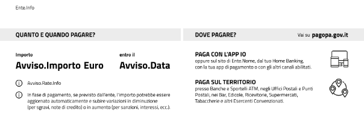

.. _howto_dataScadenzaAvvisi:

Gestione della data scadenza negli avvisi PagoPA
================================================

All'interno dell'avviso PagoPA è presente la sezione **Quanto e quando pagare** contenente le informazioni sul quanto pagare, in che modalità e con le relative scadenze.

   Sezione **Quanto e quando pagare** dell'avviso di pagamento PagoPA

L'etichetta **entro il** mostra al cittadino debitore una data che può assumere diversi significati in base alle date definite nella pendenza al momento del caricamento su GovPay.

Data scadenza e data validità nelle richieste json
~~~~~~~~~~~~~~~~~~~~~~~~~~~~~~~~~~~~~~~~~~~~~~~~~~~

E' possibile indicare all'interno di una pendenza tre differenti date opzionali:

.. code-block:: json
  :caption: Data scadenza, data validità e data scadenza avviso all'interno di una pendenza

  {
    "dataValidita": "2023-11-30",
    "dataScadenza": "2023-12-31",
    "proprieta": {
                  "dataScandenzaAvviso": "2023-12-31"
                  }
  }

La **data validità** indica fino a quando è valido l'importo corrente dell'avviso di pagamento. Un pagamento effettuato dopo questa data comporterà il ricalcolo e l'aggiornamento dell'importo in base alle procedure di integrazione previste.

D'altra parte, la **data scadenza** rappresenta la data successiva alla quale l'avviso di pagamento scade e non può più essere pagato.

La **data scadenza avviso** consente di personalizzare la data visualizzata sull'avviso di pagamento, sostituendo quella impostata tramite le precedenti proprietà.

Se durante il caricamento della pendenza non viene specificata alcuna data, allora nell'avviso l'etichetta **entro il** verrà omessa e non verrà visualizzata alcuna data.

Gestione automatica della data validità
~~~~~~~~~~~~~~~~~~~~~~~~~~~~~~~~~~~~~~~

Il sistema consente di visualizzare una data sull'avviso di pagamento per le pendenze che non specificano alcuna data, indicando il numero dei giorni di validità da assegnare alla pendenza attraverso la proprietà di sistema:

  -  **it.govpay.modello3.sanp24.giorniValiditaDaAssegnarePendenzaSenzaDataValidita=GG**

la data visualizzata nell'avviso sarà calcolata come la somma tra la data di creazione della pendenza e il numero di giorni definito nella proprietà.

Omettere la data di scadenza nell'Avviso pagoPA
~~~~~~~~~~~~~~~~~~~~~~~~~~~~~~~~~~~~~~~~~~~~~~~

In alcuni casi l'ente non vuole che l'avviso di pagamento riporti una data entro cui pagare, pur avendo valorizzato la data validità o la data scadenza della pendenza. E' il caso, ad esempio, di chi determina la scadenza progressivamente durante il processo e non vuole consegnare al cittadino un avviso con un termine destinato a essere aggiornato.

A partire dalla versione 3.10.0 è possibile ottenere questo comportamento valorizzando la proprietà **nascondiDataScadenzaAvviso** della pendenza:

.. code-block:: json
  :caption: Pendenza con data scadenza omessa sull'avviso di pagamento

  {
    "dataValidita": "2023-11-30",
    "dataScadenza": "2023-12-31",
    "proprieta": {
                  "nascondiDataScadenzaAvviso": true
                  }
  }

Con la proprietà attiva, nella sezione **Quanto e quando pagare** non viene riportata alcuna data: l'avviso si presenta come quello di una pendenza caricata senza date. La proprietà è facoltativa e, se assente o valorizzata a *false*, l'avviso continua a riportare la data come descritto nelle sezioni precedenti.

La proprietà agisce solo su ciò che viene stampato sull'avviso: le date restano sulla pendenza e continuano a determinarne la pagabilità, la scadenza, i promemoria e le notifiche.

La data riportata sull'avviso viene quindi scelta con il seguente ordine di precedenza:

1. se **nascondiDataScadenzaAvviso** vale *true*, non viene riportata alcuna data;
2. altrimenti la **data scadenza avviso**, se valorizzata;
3. altrimenti la **data validità**, se valorizzata;
4. altrimenti la **data scadenza**, se valorizzata;
5. altrimenti la data di creazione della pendenza più i giorni indicati nella proprietà di sistema descritta nella sezione precedente, se configurata;
6. in assenza di tutte le precedenti, non viene riportata alcuna data.

.. note::
   Per omettere una data non vanno inviati valori convenzionali come *0001-01-01*: GovPay li considera date a tutti gli effetti e li riporta sull'avviso. I campi relativi alle date vanno omessi.
