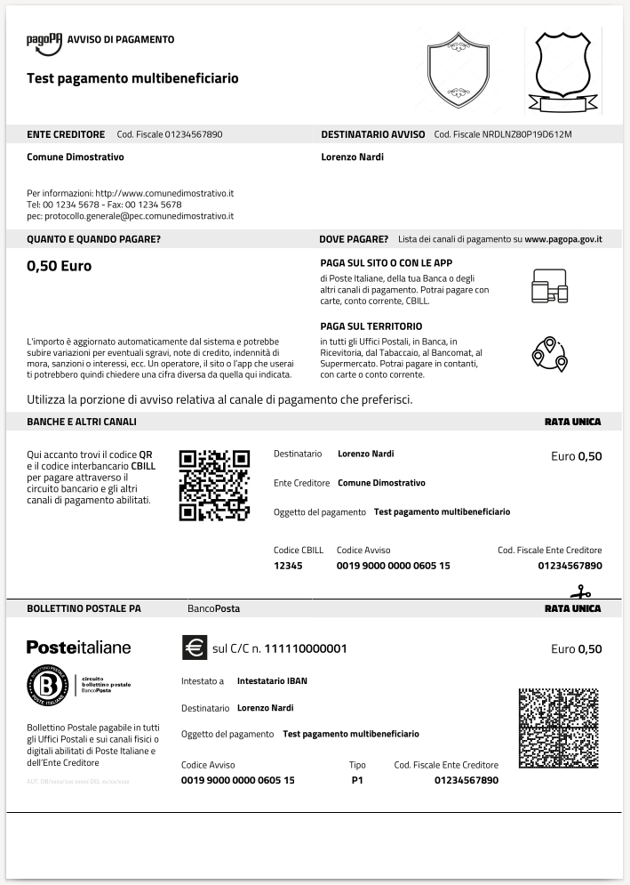

.. _howto_multibeneficiario:

Pagamento multibeneficiario
===========================

Le SANP 2.5 introducono la possibilità di effettuare pagamenti multibeneficiario, ovvero di eseguire la riscossione di importi per enti creditori non intermediati,
come ad esempio è risultato necessario per il pagamento del tributo comunale TARI contestualmente alla quota TEFA a beneficio delle provincie. 

**ATTENZIONE**: Questo scenario richiede che la stazione sia configurata sul Portale delle Adesioni per operare con la versione 2 dei servizi pagoPA.

La realizzazione dello scenario è piuttosto semplice:

 #. Registrare l'Ente beneficiario lasciando disattivato il campo *Intermediato* (vedi :ref:`govpay_configurazione_enti`)
 #. Censire tra gli *Iban* dell'Ente beneficiario il relativo conto di accredito (vedi :ref:`govpay_configurazione_enti`)
 #. Predisporre la pendenza indicando l'importo del beneficiario come ulteriore voce di pendenza, avendo cura di valorizzare opportunamente l'idDominio del creditore.
  
Vediamo ad esempio un pendenza per il pagamento TARI-TEFA, dove il Comune (idDominio 01234567890) è intermediato, mentre la provincia (idDominio 09876543210) non lo è:

.. code-block:: json
   :caption: Pendenza multibeneficiaria

   {
      "idTipoPendenza":"TARI",
      "idDominio":"01234567890",
      "causale":"Test pagamento multibeneficiario",
      "soggettoPagatore":{
         "tipo":"F",
         "identificativo":"RSSMRA30A01H501I",
         "anagrafica":"Mario Rossi"
      },
      "importo":0.5,
      "voci":[
         {
            "idVocePendenza":"TARI",
            "importo":0.4,
            "descrizione":"Importo TARI",
            "ibanAccredito":"IT02L1234500000111110000001",
            "tipoContabilita":"ALTRO",
            "codiceContabilita":"0101101IM/"
         },
         {
            "idVocePendenza":"TEFA",
            "importo":0.1,
            "descrizione":"Importo TEFA",
            "idDominio":"09876543210",
            "ibanAccredito":"IT02L1234500000333330000003",
            "tipoContabilita":"ALTRO",
            "codiceContabilita":"0201102IM/"
         }
      ]
   }

L'avviso di pagamento corrispondente si presenta come segue e risulterà pagabile come un qualsiasi altro avviso:

   Avviso di pagamento multibeneficiario

Le riscossioni relative agli enti creditori non intermediati risulteranno nelle API
di tipo `ENTRATA_PA_NON_INTERMEDIATA`.
