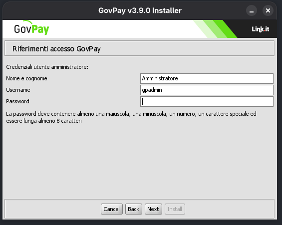
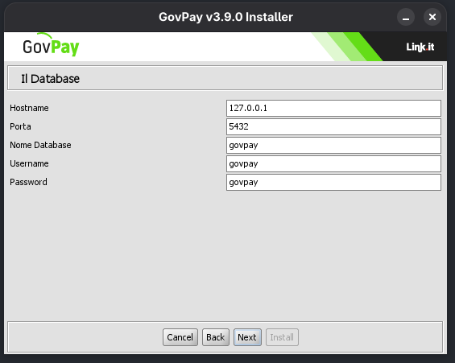
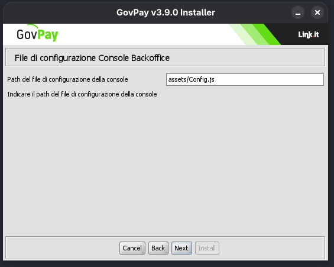
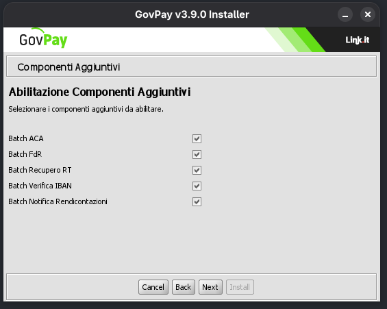
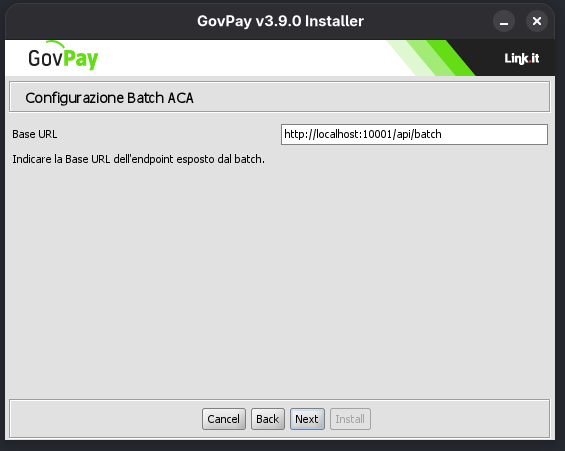
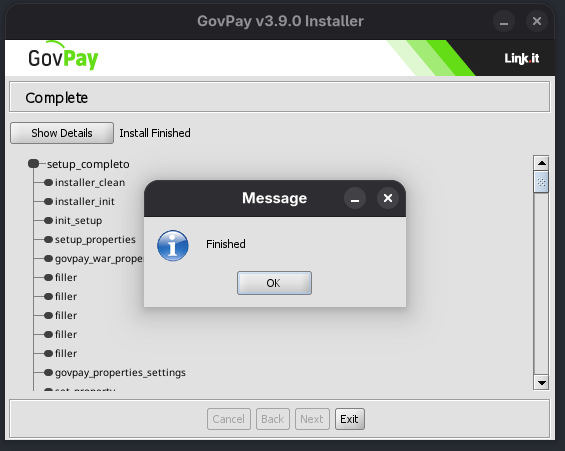

.. _inst_configurazione:

Configurazione dei moduli applicativi
=====================================

La fase di configurazione dei moduli applicativi consente di impostare i
dati di riferimento del proprio ambiente di installazione, tramite una
procedura basata sul modello wizard.

Download
--------

Scaricare l'archivio ``govpay-installer-<versione>.tgz`` dell'ultima versione
dalla pagina delle release di GovPay: https://github.com/link-it/govpay/releases.

In alternativa l'installer si produce dai sorgenti come descritto in
:ref:`inst_compilazione`.

Esecuzione dell'Installer
-------------------------

L'archivio di installazione può essere scompattato e il relativo
installer eseguito su un ambiente che non deve essere necessariamente
quello di destinazione. Infatti l'Installer non installa il prodotto ma
produce tutti gli elementi necessari che dovranno essere dispiegati
nell’ambiente di esercizio.

Per l'esecuzione dell'installer verificare ed eventualmente impostare la
variabile d’ambiente **JAVA_HOME** in modo che riferisca la directory
radice dell'installazione di Java. Eseguire quindi l'installer mandando
in esecuzione il file **install.sh** su Unix/Linux, oppure
**install.cmd** su Windows.

Avvio
~~~~~

L’Installer mostra all’avvio una pagina introduttiva.

Sono mostrate informazioni quali:

-  Nome e versione del prodotto
-  Informazioni sul copyright
-  Informazioni sulla licenza d'uso

Selezionando il pulsante Next si procede con la configurazione del
software.

   Pagina introduttiva all'avvio dell'Installer

Informazioni Preliminari
~~~~~~~~~~~~~~~~~~~~~~~~

La schermata "Informazioni Preliminari" consente di inserire i dati sul
contesto di installazione nell'ambiente di esercizio.

   Informazioni preliminari

Devono essere inserite le seguenti informazioni:

-  **DB Platform:** selezionare la piattaforma RDBMS utilizzata, tra PostgreSQL (predefinita), MySQL, Oracle, SQL Server e HyperSQL
-  **Work Folder:** inserire il path assoluto della *directory*, presente nell'ambiente di destinazione, che sarà utilizzata da GovPay per accedere a dati accessori legati alle funzionalità opzionali (predefinita ``/etc/govpay``), ad esempio:

   -  **file di configurazione personalizzati**
   -  **file di configurazione Log4j personalizzati**
   -  **file di configurazione di Spring Security personalizzati**

-  **Log Folder**: inserire il path assoluto della directory, presente nell'ambiente di destinazione, che sarà utilizzata da GovPay per inserire i diversi file di tracciamento prodotti (predefinita ``/var/log/govpay``).

Riferimenti Accesso GovPay
~~~~~~~~~~~~~~~~~~~~~~~~~~

Questo passaggio prevede che vengano inserite le credenziali del cruscotto di gestione:

Credenziali dell'utente amministratore:

-  **Nome e Cognome:** nome e cognome da associare alle credenziali di amministrazione
-  **Username:** indicare l'identificativo dell'utenza di amministrazione per l'accesso alla console di gestione e monitoraggio (predefinito ``gpadmin``).
-  **Password:** indicare la password seguendo i vincoli "deve contenere almeno una maiuscola, una minuscola, un numero, un carattere speciale ed essere lunga almeno 8 caratteri". I caratteri speciali ammessi sono ``! @ # $ % ^ &``.

   Riferimenti Accesso GovPay

Il Database
~~~~~~~~~~~

Nella schermata "Il Database" si devono inserire i riferimenti per
l'accesso al database di esercizio di GovPay.

   Informazioni accesso al DB

-  **Hostname**: indirizzo per raggiungere il database
-  **Porta**: la porta da associare all’hostname per la connessione al
   database
-  **Nome Database**: il nome dell’istanza del database a supporto di
   GovPay.
-  **Username**: l’utente con diritti di lettura/scrittura sul database
   sopra indicato.
-  **Password**: la password dell’utente del database.

.. note::
    Non è necessario che il database e l'utente indicato esistano in questa fase. Potranno essere creati nella successiva fase di dispiegamento purché i dati relativi coincidano con i valori inseriti in questi campi del wizard.

Servizi Backoffice
~~~~~~~~~~~~~~~~~~

Nella schermata "Servizi Backoffice" si devono inserire i riferimenti alle BaseURL delle risorse utilizzate dal cruscotto.

   Configurazione Servizi Cruscotto

-  **Base path risorse statiche console**: BaseURL dove il cruscotto ricerca le risorse statiche (predefinito ``/govpay-console/``)
-  **Base path API Backoffice**: BaseURL delle API-Backoffice (predefinito ``/govpay-api-backoffice``)

File di configurazione Console Backoffice
~~~~~~~~~~~~~~~~~~~~~~~~~~~~~~~~~~~~~~~~~

Nella schermata "File di configurazione Console Backoffice" si deve inserire il riferimento al file di configurazione utilizzato dal cruscotto.

   File di configurazione Console Backoffice

-  **Path del file di configurazione della console**: Il path del file di configurazione della console (predefinito ``assets/Config.js``)

Configurazioni Avanzate
~~~~~~~~~~~~~~~~~~~~~~~

La schermata "Configurazioni Avanzate" consente di configurare opzioni avanzate del prodotto.

   Configurazioni Avanzate

**Configurazione Spring Security**

-  **Usa file di configurazione esterni:** opzione che abilita i file di configurazione esterni di Spring per l'accesso alle funzionalità avanzate, come la configurazione delle modalità di autenticazione (:ref:`inst_dispiegamento_auth`).

Componenti Aggiuntivi
~~~~~~~~~~~~~~~~~~~~~

La schermata "Componenti Aggiuntivi" consente di selezionare i batch esterni da abilitare. I componenti sono descritti in :ref:`inst_componenti_aggiuntivi`.

   Componenti Aggiuntivi

I batch esterni selezionabili sono:

-  **Batch ACA:** invio delle posizioni debitorie all'Archivio Centralizzato degli Avvisi (ACA) di pagoPA
-  **Batch FdR:** acquisizione dei Flussi di Rendicontazione (FdR) da pagoPA
-  **Batch Verifica IBAN:** verifica degli IBAN e dell'anagrafica degli Enti Creditori su pagoPA
-  **Batch Notifica Rendicontazioni:** notifica alle applicazioni dell'ente delle rendicontazioni senza pagamento associato e, se abilitato, spedizione delle ricevute
-  **Batch Maggioli JPPA:** notifica delle ricevute di pagamento al gateway Maggioli JPPA

Per ciascun batch selezionato verrà presentata una schermata di configurazione dove inserire la **Base URL** dell'endpoint esposto dal batch.
La schermata del **Batch Recupero RT** è sempre presentata e la sua Base URL è obbligatoria: dalla versione 3.10 il recupero delle ricevute mancanti è svolto solo da questo componente esterno.

Le Base URL proposte sono:

.. list-table::
   :header-rows: 1

   * - Batch
     - Base URL predefinita
     - Proprietà valorizzata in ``govpay.properties``
   * - ACA
     - ``http://localhost:10001/api/batch``
     - ``it.govpay.batch.aca.endpoint.url``
   * - FdR
     - ``http://localhost:10005/api/batch``
     - ``it.govpay.batch.fdr.endpoint.url``
   * - Recupero RT
     - ``http://localhost:10006/api/batch``
     - ``it.govpay.batch.recuperoRT.endpoint.url``
   * - Verifica IBAN
     - ``http://localhost:10008/api/batch``
     - ``it.govpay.batch.iban.endpoint.url``
   * - Notifica Rendicontazioni
     - ``http://localhost:10009/api/batch``
     - ``it.govpay.batch.notifica.endpoint.url``
   * - Maggioli JPPA
     - ``http://localhost:10007/api/batch``
     - ``it.govpay.batch.maggioli.endpoint.url``

GovPay usa queste URL per avviare i batch e leggerne lo stato dalla sezione Manutenzione della console.
Per ogni batch si possono impostare a mano in ``govpay.properties`` anche i timeout, in millisecondi:
``it.govpay.batch.<batch>.endpoint.connectionTimeout`` (predefinito 5000), ``readTimeout`` (30000)
e ``connectionRequestTimeout`` (5000).

   Configurazione Batch ACA

   Configurazione Batch FdR

   Configurazione Batch Recupero RT

   Configurazione Batch Verifica IBAN

   Configurazione Batch Notifica Rendicontazioni

Installazione
~~~~~~~~~~~~~

Premendo il pulsante **Install** il processo di configurazione termina
con la produzione dei files necessari per l’installazione di GovPay che
verranno inseriti nella nuova directory **dist** creata al termine di
questo processo.

   Installazione terminata

I files presenti nella directory **dist** dovranno essere utilizzati
nella fase successiva di dispiegamento di GovPay.

.. _inst_componenti_aggiuntivi:

Componenti Aggiuntivi
---------------------

GovPay può essere esteso con componenti aggiuntivi che forniscono funzionalità opzionali.
Questi componenti sono distribuiti separatamente e possono essere installati in base alle esigenze.
Ogni componente descrive configurazione, esecuzione e immagine Docker nel README del proprio repository;
di seguito sono indicati lo scopo e cosa va configurato in GovPay perché funzioni.

I batch si avviano da uno scheduler interno, oppure a richiesta tramite la loro API REST
(usata da GovPay per l'esecuzione manuale dalla console), e si coordinano tra più istanze
con i metadati Spring Batch sul database. Le loro chiamate sono registrate nel Giornale
degli Eventi tramite govpay-gde-api.

govpay-aca-batch
~~~~~~~~~~~~~~~~

Batch per l'invio delle posizioni debitorie all'Archivio Centralizzato degli Avvisi (ACA) di pagoPA,
tramite il servizio GPD (Gestione Posizioni Debitorie).

- **Repository:** https://github.com/link-it/govpay-aca-batch
- **Release:** https://github.com/link-it/govpay-aca-batch/releases

Ogni 10 minuti (predefinito) individua le pendenze da pagare o annullate non ancora comunicate
dopo l'ultima modifica e le invia al GPD: crea e pubblica le posizioni nuove, aggiorna quelle già
inviate e annulla quelle annullate in GovPay.

**Configurazione in GovPay:** il connettore ACA dell'intermediario (URL del GPD e credenziali).

govpay-fdr-batch
~~~~~~~~~~~~~~~~

Batch per l'acquisizione dei Flussi di Rendicontazione (FdR) da pagoPA.

- **Repository:** https://github.com/link-it/govpay-fdr-batch
- **Release:** https://github.com/link-it/govpay-fdr-batch/releases

Scarica i flussi pubblicati dopo l'ultimo già acquisito, li salva nel database di GovPay
e li collega alle pendenze rendicontate.

**Configurazione in GovPay:** l'acquisizione delle rendicontazioni abilitata sul dominio e il
connettore FR dell'intermediario.

govpay-rt-batch
~~~~~~~~~~~~~~~

Batch per il recupero delle Ricevute Telematiche (RT) mancanti. Dalla versione 3.10 è l'unico
meccanismo di recupero delle ricevute ed è quindi necessario.

- **Repository:** https://github.com/link-it/govpay-rt-batch
- **Release:** https://github.com/link-it/govpay-rt-batch/releases

Questo componente:

- individua le rendicontazioni acquisite negli ultimi N giorni (``govpay.batch.finestra-temporale``,
  predefinito 90) che hanno una pendenza ma nessun pagamento in GovPay;
- scarica la ricevuta dall'API pagoPA ``GET /organizations/{organizationfiscalcode}/receipts/{iur}/paymentoptions/{iuv}``;
- invia la ricevuta al core come ``paSendRTV2``, sul servizio
  ``/govpay-api-pagopa/internal/PagamentiTelematiciCCPservice``, come se arrivasse dal Nodo dei Pagamenti;
- elabora le richieste di recupero puntuale inserite da un operatore dalla console.

**Configurazione in GovPay:** il connettore Recupero RT dell'intermediario (URL e chiave dell'API pagoPA)
e un'utenza con cui il batch si autentica in Basic sul servizio ``/internal`` delle API pagoPA.

govpay-iban-batch
~~~~~~~~~~~~~~~~~

Batch per la verifica degli IBAN e dell'anagrafica degli Enti Creditori su pagoPA.

- **Repository:** https://github.com/link-it/govpay-iban-batch
- **Release:** https://github.com/link-it/govpay-iban-batch/releases

Confronta gli IBAN e gli Enti Creditori registrati su pagoPA con quelli di GovPay, salva l'esito
in una cache usata dalla console per il censimento assistito e produce un report CSV, che può
essere spedito per email.

**Configurazione in GovPay:** il connettore di backoffice EC dell'intermediario.

govpay-notify-batch
~~~~~~~~~~~~~~~~~~~

Batch per la notifica alle applicazioni dell'ente delle rendicontazioni senza pagamento e,
se abilitato, per la spedizione delle ricevute.

- **Repository:** https://github.com/link-it/govpay-notify-batch
- **Release:** https://github.com/link-it/govpay-notify-batch/releases

Questo componente:

- notifica all'applicazione proprietaria della pendenza, con ``POST /rendicontazioni`` dell'API Ente,
  le rendicontazioni acquisite che non hanno un pagamento in GovPay (ogni 2 ore, predefinito);
- se abilitato, spedisce le ricevute in coda con ``PUT /ricevute/{idDominio}/{iuv}/{idRicevuta}``.

**Configurazione in GovPay:** il connettore di integrazione dell'applicazione, con versione API ``REST_2``
(l'unica supportata).

govpay-maggioli-jppa
~~~~~~~~~~~~~~~~~~~~

Batch per la notifica delle ricevute di pagamento al gateway Maggioli JPPA.

- **Repository:** https://github.com/link-it/govpay-maggioli-jppa
- **Release:** https://github.com/link-it/govpay-maggioli-jppa/releases

Per ogni dominio abilitato invia al gateway le ricevute positive arrivate dopo l'ultima già notificata
e, se previsto, spedisce per email un tracciato con l'esito.

**Configurazione in GovPay:** il connettore Maggioli JPPA del dominio (vedi :ref:`govpay_configurazione_connettori_jppa`)
e, per l'esecuzione manuale, la Base URL del batch indicata all'installazione (``it.govpay.batch.maggioli.endpoint.url``).

govpay-gde-api
~~~~~~~~~~~~~~

API per il Giornale degli Eventi (GDE) dei componenti esterni.

- **Repository:** https://github.com/link-it/govpay-gde-api
- **Release:** https://github.com/link-it/govpay-gde-api/releases

Riceve gli eventi prodotti dai componenti esterni e li salva nella tabella ``eventi`` del database
di GovPay, dove sono consultabili dalla console insieme a quelli del core.

**Configurazione in GovPay:** il connettore del servizio Giornale degli Eventi, nelle Impostazioni
della console, con la URL del servizio. Il servizio non applica autenticazione e va esposto solo
sulla rete interna dei componenti.

govpay-stampe-api
~~~~~~~~~~~~~~~~~

Servizio di stampa in PDF di avvisi di pagamento e ricevute, usato dai componenti esterni.

- **Repository:** https://github.com/link-it/govpay-stampe-api
- **Release:** https://github.com/link-it/govpay-stampe-api/releases

Non ha base dati e non applica autenticazione: va esposto solo sulla rete interna dei componenti.

govpay-portal-api
~~~~~~~~~~~~~~~~~

API per il portale dei pagamenti del cittadino: enti e tipi pendenza pagabili, pendenze del
debitore, pagamento spontaneo, avvisi e ricevute in PDF.

- **Repository:** https://github.com/link-it/govpay-portal-api
- **Release:** https://github.com/link-it/govpay-portal-api/releases
