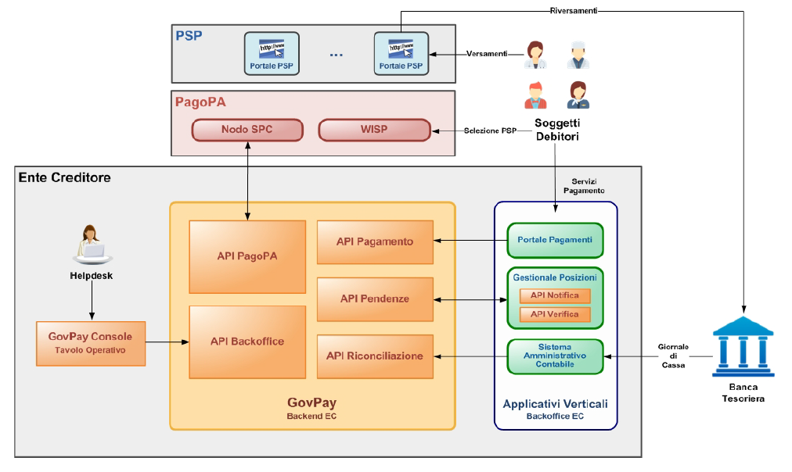

.. _integrazione_architettura:

L'architettura della piattaforma di pagamento
=============================================

Nella figura seguente è sintetizzato lo scenario architetturale di
riferimento, evidenziando il ruolo di GovPay, dei sistemi dell'Ente
Creditore e dei servizi centrali del progetto pagoPA.

   Architettura della piattaforma di pagamento

Gli Attori principali del Progetto pagoPA
-----------------------------------------

I componenti principali della piattaforma pagoPA, erogati da
PagoPA S.p.A., sono:

-  il *Nodo dei Pagamenti*: componente che funge da gateway tra gli Enti Creditori e i PSP aderenti alla piattaforma;
-  il *Checkout*: interfaccia che guida l'utente nella scelta del PSP e dello strumento con cui perfezionare il pagamento;
-  i servizi *GPD/ACA* (Gestione Posizioni Debitorie e Archivio Centralizzato Avvisi), per la pubblicazione delle posizioni debitorie sulla piattaforma;
-  il servizio *FdR* (Flussi di Rendicontazione), da cui si acquisiscono le rendicontazioni dei PSP;
-  il servizio *Biz Events*, da cui si possono recuperare le ricevute di pagamento.

Gli attori che interagiscono nell'ambito del progetto sono:

*  l'*Ente Creditore*, aderente a pagoPA e interessato alla
   pubblicazione sulla piattaforma delle proprie posizioni debitorie, a
   governare l'iter del loro pagamento ed alla successiva gestione
   dell'incassato.
*  i *Soggetti Debitori*: cittadini, o altri soggetti, che detengono
   posizioni pendenti o richiedono servizi soggetti a pagamento verso
   l'Ente Creditore;
*  i *PSP*: i Prestatori di Servizi di Pagamento aderenti a pagoPA.
   Ciascun PSP espone un'interfaccia web, il Portale PSP, per permettere
   al cittadino di perfezionare i pagamenti delle posizioni presenti su
   pagoPA;
*  la *Banca Tesoriera*: Istituti gestori dei conti di accredito
   dell'Ente Creditore.

I principali attori interni all'Ente Creditore
----------------------------------------------

Questo documento si concentra sull'organizzazione interna dell'Ente
Creditore, al fine di focalizzare le esigenze di integrazione dei
diversi software applicativi dell'Ente. A tal fine nella figura appena vista sono stati introdotti i principali attori interni all'Ente
Creditore, ovvero:

-  *Helpdesk*: Personale dedicato ai servizi di helpdesk di primo o
   secondo livello inerenti ai pagamenti pagoPA.
-  *Portale di Pagamento*: I portali dedicati ai pagamenti nel dominio
   amministrativo dell’Ente Creditore.
-  *Gestionale Posizioni*: Il verticali competenti per le diverse
   posizioni debitorie afferenti all'Ente Creditore.
-  *Sistema Amministrativo Contabile*: applicazioni verticali che
   ricevono il giornale di cassa dalle Banche Tesoriere che attestano i
   riversamenti dei PSP debitori sui conti di accredito dell'Ente
   Creditore e responsabili della riconciliazione con i pagamenti
   operati sulla piattaforma pagoPA.
-  *GovPay*: gateway di pagamento verso la piattaforma pagoPA che
   realizza le funzioni di backend richieste dalle specifiche pagoPA.
   Consente l’integrazione Application-To-Application dei portali di
   pagamento e dei sistemi verticali dell'Ente creditore tramite le
   seguenti API:

   -  *API Pendenze*: Servizi per l'interscambio dei dati relativi alle
      pendenze di pagamento, ad uso dei verticali gestori delle
      posizioni debitorie.
   -  *API Ragioneria*: Servizi dedicati ai sistemi degli Uffici
      Amministrativi Contabili dell’Ente Creditore responsabili della
      riconciliazione dei pagamenti (riconciliazioni, riscossioni,
      rendicontazioni e ricevute).
   -  *API Backoffice*: Servizi dedicati all'integrazione di cruscotti
      di gestione e monitoraggio alternativi alla GovPay Console.
   -  *API pagoPA*: i servizi *paForNode* del modello unico
      (``paVerifyPaymentNotice``, ``paGetPayment`` e ``paGetPaymentV2``,
      ``paSendRT`` e ``paSendRTV2``, ``paDemandPaymentNotice``) invocati
      dal Nodo dei Pagamenti.

-  *GovPay Console*: Interfaccia utente attraverso cui gli operatori
   abilitati dell’Amministrazione possono configurare la piattaforma di
   pagamento e monitorarne l'operatività sia dei processi di pagamento
   che di riconciliazione. Realizza le funzioni di Tavolo Operativo
   richiesti dalle specifiche pagoPA.

Componenti della piattaforma
----------------------------

Oltre alle API e alla console del core, alcune funzioni della piattaforma
sono realizzate da componenti distribuiti separatamente, ciascuno con il
proprio repository e README (vedi :ref:`inst_componenti_aggiuntivi`):

-  *govpay-fdr-batch*: acquisizione dei Flussi di Rendicontazione da pagoPA;
-  *govpay-rt-batch*: recupero delle ricevute di pagamento mancanti;
-  *govpay-aca-batch*: invio delle posizioni debitorie all'Archivio Centralizzato Avvisi tramite il servizio GPD;
-  *govpay-notify-batch*: notifica alle applicazioni dell'Ente delle rendicontazioni senza pagamento e, se abilitata, spedizione delle ricevute;
-  *govpay-iban-batch*: verifica degli IBAN e dell'anagrafica degli Enti Creditori su pagoPA;
-  *govpay-maggioli-jppa*: notifica delle ricevute di pagamento al gateway Maggioli JPPA;
-  *govpay-gde-api* e *govpay-stampe-api*: Giornale degli Eventi e stampa di avvisi e ricevute per i componenti esterni;
-  *govpay-portal* e *govpay-portal-api*: portale dei pagamenti del cittadino e relative API (consultazione delle pendenze, pagamento spontaneo, avvisi e ricevute);

Nel seguito saranno descritte le modalità di integrazione richieste ai
sistemi applicativi dell'Ente Creditore, facendo riferimento a diverse
varianti dei seguenti casi d'uso:

.. csv-table:: Varianti dei casi d'uso
  :header: "Sintesi", "Descrizione"
  :widths: 30,70
  
  "Pagamenti ad iniziativa Ente", "Scenari d’utilizzo in cui il soggetto debitore utilizza il portale dei pagamenti dell’ente per effettuare uno o più pagamenti"
  "Pagamenti ad iniziativa PSP", "Scenari d’utilizzo in cui l’utente effettua uno o più pagamenti presso il PSP tramite gli avvisi di pagamento"  
  "Riconciliazione dei pagamenti", "Scenari di utilizzo di GovPay che coinvolgono i sistemi contabili dell’ente, responsabili della riconciliazione dei pagamenti realizzati da pagoPA con le entrate in tesoreria"  
