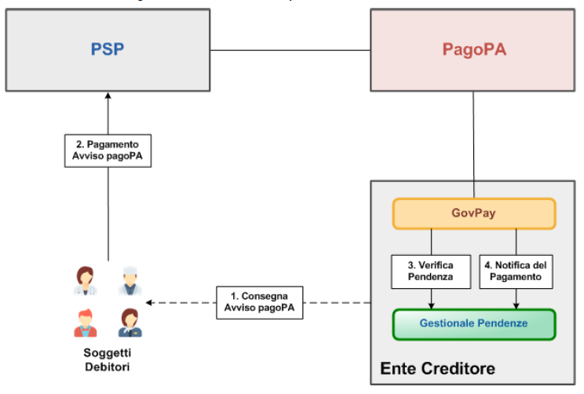

.. _integrazione_pagamentipsp:

Pagamenti ad iniziativa PSP
===========================

Il cittadino, provvisto di un Avviso di Pagamento
pagoPA relativo ad una pendenza, si reca presso le strutture del PSP
(sportello, ATM, Home banking, Mobile APP, etc...) per l’esecuzione del
versamento.

   Pagamento ad iniziativa PSP

Il flusso di questo scenario è il seguente:

1. L’Ente Creditore, alla predisposizione di una nuova pendenza, stampa
   l’Avviso di Pagamento pagoPA ad essa associata e la consegna al
   Soggetto Debitore, in formato digitale o cartaceo, secondo le
   modalità previste dell'Ente.
2. Munito dell'avviso, il Soggetto Debitore interagisce con il PSP che
   acquisisce gli estremi dell'Avviso, tramite scansione dei glifi
   grafici o trascrizione manuale dei codici di riferimento.
3. Il PSP verifica gli estremi di pagamento della pendenza,
   eventualmente interagendo con il Gestionale Pendenze, e li prospetta
   al Soggetto Debitore.
4. Il Soggetto Debitore perfeziona il pagamento e GovPay lo notifica al
   Gestionale Pendenze.

Nell’ambito di questa tipologia di pagamento individuiamo i seguenti
casi:

-  Consegna dell’Avviso di Pagamento

L’ente creditore, alla predisposizione di una nuova pendenza, stampa
l’Avviso di Pagamento pagoPA ad essa associata e la consegna al
cittadino.

-  Verifica della pendenza collegata all'Avviso di Pagamento

Il cittadino si reca presso il PSP per pagare tramite l'avviso Avviso di
Pagamento. Il sistema verifica gli estremi della pendenza associata
prima di autorizzare le operazioni di riscossione dell'importo dovuto.

-  Notifica del pagamento di un Avviso di Pagamento

Al termine delle operazioni di riscossione, il gestionale viene
notificato dell'esito del pagamento per aggiornare lo stato della
pendenza.

Avvisatura della pendenza
-------------------------

L’ente creditore, alla predisposizione di una nuova pendenza, ottiene la
stampa dell’Avviso di Pagamento pagoPA ad essa associato e lo consegna
al cittadino. E' sufficiente indicare nella richiesta di caricamento di
una pendenza (invocando l'operazione *PUT
/pendenze/{idA2A}/{idPendenza}* delle API Pendenze) il parametro
*stampaAvviso* valorizzato a true.

Se il tipo pendenza lo prevede, GovPay notifica inoltre l'avviso al
debitore tramite email o App IO (vedi :ref:`integrazione_interfacce`),
alla data indicata nel campo *dataNotificaAvviso* della pendenza; il
parametro *dataAvvisatura* valorizzato a ``MAI`` in fase di creazione
esclude la pendenza dalle notifiche.

In alternativa, il Gestionale Pendenze può avvisare in autonomia il
pagamento generando internamente il numero avviso identificativo e non
alimentare l'archivio dei pagamenti in attesa di GovPay.

Pagamento dell'Avviso pagoPA
----------------------------

Il Soggetto Debitore avvia con il PSP il pagamento dell'Avviso pagoPA,
ad esempio tramite scansione dei codici grafici, utilizzando
l'applicazione mobile di home banking, o presentandone una stampa allo
sportello di una filiale. Questa fase non prevede nessuna interazione
con l'Ente Creditore.

Verifica della pendenza
-----------------------

Il tentativo di pagamento di un Avviso attiva una serie di verifiche da
parte della piattaforma pagoPA. GovPay gestisce il colloquio e, se
necessario, effettua verso il Gestore Pendenze titolare dell'Avviso
oggetto di pagamento una richiesta di verifica della pendenza associata
all'avviso tramite l'operazione *GET /avvisi/{idDominio}/{numeroAvviso}*
delle API Ente v2 (*GET /avvisi/{idDominio}/{iuv}* nella versione 1).

Ci sono due contesti in cui GovPay esegue la richiesta di verifica:

-  se la pendenza associata all'avviso non è presente nell'archivio dei pagamenti in attesa;

-  se la pendenza è presente in archivio, ma la data di validità comunicata risulti decorsa, pur essendo la pendenza non ancora
   scaduta;

Per data di validità si intende pertanto la data entro la quale la
pendenza non subisce variazioni ai fini del pagamento. Alla sua
decorrenza, il gestionale potrebbe applicare delle variazioni di importo
a causa di sanzioni o interessi, che saranno recepiti da GovPay al
momento del pagamento tramite le operazioni di verifica.

Quando invece decorre la data di scadenza, GovPay gestisce eventuali
verifiche che l'avviso è scaduto, interrompendone il pagamento.

Inoltre:

-  se la pendenza ha una data di pubblicazione futura (stato
   *NON_PUBBLICATA*), GovPay risponde a pagoPA che l'avviso è sconosciuto,
   senza interrogare il gestionale, fino al raggiungimento della data;
-  se la pendenza prevede l'attualizzazione delle spese di notifica SEND
   (campo *sendAbilitato*), GovPay aggiorna l'importo con le spese di
   notifica al momento della verifica.

Notifica del pagamento
----------------------

Superata la fase di verifica, il PSP perfeziona la riscossione degli
importi dovuti e completa il processo di pagamento. GovPay gestisce il
colloquio previsto con la piattaforma pagoPA e notifica l'esito delle
operazioni al Gestionale Pendenze tramite l'operazione
*PUT /ricevute/{idDominio}/{iuv}/{idRicevuta}* delle API Ente v2
(*POST /pagamenti/{idDominio}/{iuv}* nella versione 1).

Nel modello unico le ricevute sono emesse solo per i pagamenti conclusi
con successo. Se per la stessa pendenza arrivano più ricevute, il
Gestionale Pendenze deve saperle gestire distinguendole per
l'identificativo della ricevuta (*idRicevuta*, il *receiptId* di
pagoPA).

Si può consultare un esempio di invocazione delle API di integrazione, corrispondente a quando descritto sopra, nella sezione :ref:`Scenario "Pagamento di un dovuto ad iniziativa PSP" <govpay_scenari_dovuto3_realizzazione>`.
